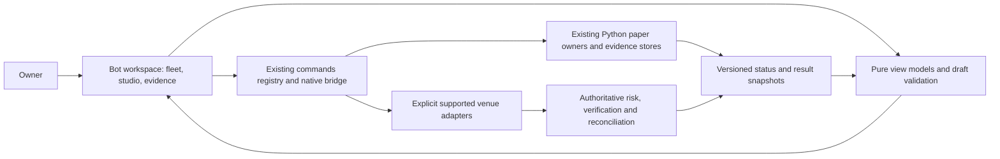

# Sol bot control room

Version: 1.0.1
Delta: v1.0.0 to v1.0.1; resolve instance identity and existing singleton worker limits after builder review.
Date: 2026-11-09
Status: proposed product design; prototype only. No production UI or trading behavior changed.

## Purpose and design call

Give the owner one place to create a bot, establish what it can actually do, and understand its current behavior. The main question is **“What is this bot doing with my capital, and why?”** Creation and monitoring must share the same configuration and evidence identity.

The requested outcome is an ideal management and creation UI. The responsive browser surface is the designer's choice, not a platform decision approved by the owner. It complements the existing terminal console and the separate CLI planning task, TASK-1092. It can become a bot workspace inside the existing extension dashboard. It is not a second trading engine.

The primary user is the technically experienced owner. They want rapid setup, automatic tuning with manual control, and immediate operational visibility. These needs are supported by existing request history, including persistent Council voting, bot P&L, wallet actions, per-coin settings and fewer workflow buttons. No interviews or participant research were performed for this proposal.

Success means the owner can find a bot's mode, health, exposure, net outcome and last decision without opening multiple screens. They can prepare a bot without confusing a saved draft with a running job. Losses, weak evidence and blocked capabilities remain easy to recognize.

## Scope and current capability boundary

All paths in this document refer to the canonical checkout. The proposal was authored in the isolated worktree /Users/mitch/dev/solmargintrader-wt-01a1c198 from commit `4d4c7a1`.

| Verified source | What exists | Design consequence |
| --- | --- | --- |
| /Users/mitch/dev/solmargintrader/soltui/bots.py:72 | DCA, Grid, Arbitrage, Trend and Council choices; workbench bots are simulations | Offer all five templates. Do not advertise unattended live support for them. |
| /Users/mitch/dev/solmargintrader/soltui/bots.py:281 | Per-coin configuration retrieval | Show the active coin and effective configuration together. |
| /Users/mitch/dev/solmargintrader/soltui/bots.py:323 | Atomic configuration save with mode checks | Keep manual mode and per-coin version ownership explicit. |
| /Users/mitch/dev/solmargintrader/soltui/paper_workflow.py:86 | Paper coordinator reuses shared owners | A “Prepare paper fleet” action should reuse existing jobs and display real stage receipts. |
| /Users/mitch/dev/solmargintrader/soltui/paper_workflow.py:122 | Stopping the coordinator leaves independent shared workers running | A stop receipt must say which owners stopped and which continue. |
| /Users/mitch/dev/solmargintrader/extension/src/core/commands.js:560 | Shared native command bridge | Reuse this boundary for an integrated UI; preserve three-surface parity. |
| /Users/mitch/dev/solmargintrader/extension/src/core/risk.js:212 | Authoritative fail-closed order gates | UI validation helps the owner; engine enforcement remains decisive. |
| /Users/mitch/dev/solmargintrader/executor/CLAUDE.md:80 | Live strategy runner is not built | A design must show missing bot execution capability instead of a pretend Start live button. |
| /Users/mitch/dev/solmargintrader/CLAUDE.md | Trigger signing and Jupiter V2 submission remain blocked; manual Coinbase is separately armed | Capability is specific to venue, product, action and verification state. No universal “live connected” badge. |
| /Users/mitch/dev/solmargintrader/docs/design/chrome-workspace/proposal.md | Existing Signal Desk design and evidence boundary | Extend its bot-monitor workflow; keep its backtest/forward/live separation. |

The interactive prototype uses synthetic examples and imports none of these modules. Its apparent controls alter only page memory. No account, secret, job, market feed or execution path is connected. The discontinued Aero LP component stays archived.

### Bot identity and concurrent instances

Every saved draft has a stable UUID. Duplicate creates a new draft UUID and never takes over an active session. A runtime session is a separate identity, owned by the backend.

The first integrated release supports **one active paper session per existing backend strategy slot**, including across markets when the current owner is strategy-scoped. In /Users/mitch/dev/solmargintrader/soltui/bots.py:1055, forward sessions are stored under the bot kind; per-coin saved settings do not establish concurrent per-coin workers. Council has its own owner. If an active slot exists, offer Open existing session or Save another draft; refuse a duplicate start. Do not overwrite it, silently reuse a different configuration, or reserve a second budget.

The ideal model can represent multiple named instances of the same strategy/market. Enabling them requires an explicit future backend `per_instance` capability with isolated worker locks, journals, configuration identity and aggregate risk accounting. That backend migration is outside the first integration plan. Until then, the studio and fleet disclose the slot limit. This is a designer's scope decision, not a claim that concurrent instances already work.

## Three directions considered

| Direction | Strength | Cost | Decision |
| --- | --- | --- | --- |
| Trading desk: fleet roster plus selected-bot inspector | Fast comparison, persistent context, inspect a decision in place | Must reflow the inspector on narrow screens | Recommended and mocked up |
| Strategy canvas: drag connected entry, exit and risk nodes | Good for complex custom strategy composition | Harder keyboard interaction; easy to hide execution semantics in wires | Later advanced view, backed by the same rule model |
| Guided launchpad: full-screen setup and one bot at a time | Clear first-run learning | Poor fleet comparison and incident awareness | Use its guided flow in Bot studio |

The memorable feature is a persistent **What it’s doing** explanation beside a readable rule and the evidence that supports it. Decorative market tickers and celebration effects would compete with that job.

## Information architecture

1. **Bot fleet:** the working home. Capital, net P&L, health, roster, selected bot, incidents and event ledger.
2. **Bot studio:** create from a template, duplicate a configuration or later import a validated strategy specification. Always opens as a draft.
3. **Research & evidence:** historical runs, prospective observations, compatible comparisons and immutable evidence detail.
4. **Activity:** bot, owner, external-wallet and risk actions with actor and source attribution.
5. **Accounts & capabilities:** account aliases, public identifiers, permissions, network and supported action matrix. Secrets never enter the UI.

Settings are secondary. The command palette finds destinations and scoped actions, but critical actions also have visible controls. Product navigation stays under six primary destinations. Drafts and selected rows must survive ordinary navigation in production.

## Fleet composition

The top context bar identifies the workspace and mode. A real implementation also shows connection age, account alias and capability. Paper and live scopes have different labels, not just different colors. Changing mode never migrates funds or configuration implicitly.

The summary strip shows paper starting capital, net P&L, capital allocated and current fleet state. Every metric has its currency, period and scope. Do not combine paper P&L with wallet balances or live results. An unavailable metric reads “Unavailable” or an em dash with an explanation, never zero.

The equity chart labels starting capital and the portfolio line. The final plotted value agrees with the displayed figure. Production charts include a table alternative, sample provenance, gaps and tooltip values; do not interpolate across outages as if trades occurred. A benchmark is only comparable when dates, capital and costs match.

The roster compares name/market, state, net P&L and last decision. A production sortable header is a button with an announced sort direction. Refreshes preserve sorting, filters, selection and keyboard focus. At narrow widths the last decision moves to the inspector; it is not discarded from the user journey.

The inspector contains:

- Bot identity, mode, effective configuration version, account and venue.
- Process state, heartbeat age, last evaluated market time and last actual decision. Process liveness and market freshness are separate.
- Plain-language current action, reason, next trigger and active blocker.
- Allocated capital, current exposure, remaining budget, net realized and net unrealized results, and included cost attribution.
- Open positions/orders, resolved fills and unresolved submissions. A production expandable detail view provides these; the prototype samples the high-level inspector.
- Historical, prospective and live evidence with their own states and identifiers.
- Scoped actions that reflect capability and ownership.

Activity stays useful when the bot does nothing: “Kept current ladder: price remained inside the range” is better than a flashing Running label. Each event has event time, received time when relevant, actor, account alias, bot/config ID, reason and correlated intent/fill ID. Unattributed wallet actions remain “external / unattributed”; never assign them to a bot by guess.

## Bot studio: five stages

### 1. Strategy

Offer DCA, Grid, Arbitrage, Trend and Council. Each template explains its behavior and one material failure mode. Template selection is a native radio group, usable without dragging or hovering. An untested template has no profit badge.

Grid offers arithmetic and geometric spacing. Neither is labelled more profitable without a matched comparison. Trend starts with the existing long-only semantics. Council explains eligible voters and stale-signal exclusion. Arbitrage distinguishes recorded quotes from candle-close research proxies and requires all-leg fee/latency evidence for any future execution.

### 2. Market & budget

Choose market, data/cost venue, account alias where supported, simulated capital and observation interval. The design uses USD-denominated example markets because the current workbench reads Coinbase market data. A future SOL/USDC Jupiter path is a distinct instrument and cost model; renaming SOL/USD is insufficient.

The sidebar preview repeats scope and budget. Multiple markets create separate configuration/evidence identities, not one tuned configuration copied across all coins. The prototype permits a single market at a time. Arbitrage uses the fixed example USD/SOL/ETH triangle and labels that scope.

### 3. Rules & tuning

Use simple typed forms, then an always-visible readable rule: **when / action / exit / conditions that prevent action**. The compact prototype demonstrates template parameters; production must expose every actual parameter through a schema-driven form, including advanced fields, units, defaults, bounds and dependencies.

Automatic proposals are the default. Manual mode freezes the user's values. An automatic proposal shows current versus proposed configuration, the exact coin, matching evidence, expected behavior change and adoption status. “Tentative” is a separate evidence state and never means statistically confirmed. A losing valid run remains visible; a failed run is a different outcome.

Edits make a new immutable draft version. Editing a running bot cannot silently change active behavior. Production shows a diff and stages the change at an acknowledged decision boundary. Existing intents retain their original version.

### 4. Risk boundaries

Show maximum allocation/exposure, daily loss, slippage, input age, trade size/frequency and allowed assets/venues as applicable. The prototype samples exposure, loss, slippage and age. Numeric fields show exact units and an equivalent percentage where useful: `30 bps = 0.30%`. Refuse NaN, infinity, empty strings, impossible dependencies and unavailable execution prices/costs.

Inherited account/engine ceilings appear beside per-bot limits. The effective limit is the stricter value. The UI cannot weaken engine rails. Server-side validation repeats every money-related check. Missing risk state blocks action.

### 5. Review & test

Summarize strategy/version, market, account/mode, readable rules, capital, all effective limits, cost assumptions, optimization policy and evidence status. Keep Edit links in production. “Save paper draft” does exactly that: no worker, observation, reservation or order starts. The prototype adds a memory-only draft to show the resulting state.

In production, offer a separate **Prepare paper bot** action after valid configuration. It shows one transparent plan: validate data → historical assessment → prospective paper observation → evaluate tuning proposals. Reuse eligible existing jobs. Display queued/running/completed/partial/failed/canceled stages, owner, progress, cancel scope and retryable reason. A losing backtest may still justify an explicitly requested paper investigation; it does not become “passed” evidence.

Live activation is a separate capability review. Show supported venue/product/action, reconciled exposure, exact configuration/evidence identity, limits and authorization policy. Preserve the owner's existing explicit fast/no-confirmation preference where supported; do not insert a fresh confirmation per automatic tick. Unknown submissions, unavailable economics, unsupported capability and failed risk gates remain hard blockers regardless of confirmation preference.

## States and action semantics

Treat mode, lifecycle, data quality, evidence and execution certainty as independent dimensions. A single status string cannot represent them honestly.

| Dimension | States | Presentation / consequence |
| --- | --- | --- |
| Mode | paper, live | Persistent text; never mixed in result totals |
| Lifecycle | draft, queued, starting, running, paused, stopping, stopped, failed, interrupted | Receipt-backed state; process loss becomes interrupted |
| Inputs | fresh, stale, missing, gap, disconnected | Data age and reason; new intents held when policy fails |
| Evidence | untested, pending, valid loss, valid gain, failed measurement, tentative, confirmed under policy | Method, sample, scope and limitations remain inspectable |
| Submission | prepared, submitted, confirmed, rejected, unknown | Unknown requires venue/chain reconciliation; never auto-retry |

**Pause entries:** stop creating new entry intents for the specified bot. It does not promise to cancel existing orders, flatten exposure, stop a recorder or release shared workers. Resume requires current eligibility and an acknowledged backend receipt. The prototype deliberately cannot resume held Council signals.

**Stop bot:** request that bot's worker stop and show the terminal receipt; retain positions and journals. **Cancel orders:** a separate scoped venue operation with partial/unknown outcomes. **Close position:** a separate verified execution action with quote/economics and account scope. **Emergency stop:** use the actual engine kill/disarm semantics and show what remains exposed. Do not relabel an entry-pause button as a global kill switch.

Production bulk actions show eligible/skipped/failed counts for each bot and preserve item receipts. One unknown item must not produce “All stopped.” Browser closure cannot imply cancellation, disarm or successful job stop.

Empty fleet: explain the first useful action and offer Create bot. Loading: reserve layout and show which source is pending. Offline: retain last-known state with its timestamp and hold new actions. Permission denied: show the missing capability and supported remedy. Long-running work: progress and cancellation remain available. Error recovery preserves drafts and already-completed evidence. No repeated starts from a stale button or reconnect.

## Visual system

Use a quiet light work surface with a deep blue navigation rail. Blue means primary action/selection, green means a positive result or running state with text, amber means a held condition, and red means a negative result/error. Never make red mean both a sell instruction and an error without explicit labels.

| Token | Value / rule |
| --- | --- |
| Canvas / surface | `#f2f5f9` / `#ffffff` |
| Primary text / secondary text | `#172942` / `#53657b` |
| Primary action / navigation | `#2757c4` / `#142d50` |
| Positive / attention / negative | `#14654f` / `#805108` / `#ac354b` |
| Typography | Avenir Next/Avenir on macOS; Segoe UI fallback; no network font dependency |
| Scale | 32px page heading, 24–25px financial emphasis, 17px section title, 14px base; compact metadata is secondary |
| Spacing | 4/8px base; 16/24/32px group spacing |
| Corners | 6px controls; 10px panels; circle reserved for actor/state markers |
| Numbers | Tabular figures; explicit currency, sign, precision and period |
| Controls | 44px target design goal; visible 3px focus outline; native controls first |

Do not imply that small prototype metadata is a validated production readability choice. Validate legibility with the owner at actual display scale; production should support a comfortable density mode and text enlargement. Do not introduce decorative charts, fabricated confidence percentages or profit celebrations. Motion answers user actions and respects reduced motion.

At ≥1200px use the roster and inspector side by side. Between 720 and 1000px the inspector moves below the roster while retaining its content. At ≤720px navigation becomes a horizontal local destination strip, metrics use two columns, creation steps compress and forms stack. Table scrolling is local if needed; the page itself must reflow at 320px. The application cannot disable browser zoom. Mobile keeps mode, blockers and meaningful controls visible.

## Architecture proposal

Use the existing no-build ESM/HTML/CSS conventions. Keep presentation, view-state derivation and side-effect dispatch separate inside the current extension. Do not add a framework, a second backend, a signer or copied strategy logic to ship a new look. These are proposed components; the prototype files are not production modules.

This is a proposed responsibility diagram, not an implemented network contract. Existing authentication, command envelopes and local native boundaries govern integration. Designing new remote endpoints is outside this design task.

**UI view model:** identify bot, version, strategy kind, market, mode, capability, lifecycle, owner/heartbeat, input freshness, decision/reason, allocation/exposure, nullable result components, evidence references and unresolved intent count. Derive labels from explicit fields. Never infer “running” from a positive P&L or “flat” from missing positions.

**Draft model:** versioned configuration with typed parameter values/units, per-market tuning mode, effective risk limits, cost model and schema version. Save/restore drafts independently from running configuration. Persist only safe configuration; keys and bearer tokens never appear in a form, export, DOM or sync storage.

**Command boundary:** user gestures request existing registered commands; the backend validates ownership, current version and capability. Use idempotency at the existing owner/dispatch boundary. A delayed response cannot overwrite a newer market, selection, configuration or command receipt. Reconcile before new plans. Do not translate UI pause into an unrelated coordinator stop.

**Result identity:** strategy/config version, market, dataset/proof hash, dates, interval, engine version, cost model and result mode. Missing values remain unavailable. Compare only compatible evidence; show both when compatibility fails. Current summaries lack some desired path/equity/fee detail, so richer visualizations wait for typed measured fields.

### Proposed decisions and tradeoffs

- **ADR-UI-1, proposed:** integrate the bot workspace into the existing extension rather than creating a parallel execution application. Benefit: shared routing, defaults and safety boundary. Cost: extension lifecycle and native-host constraints remain.
- **ADR-UI-2, proposed:** table/inspector for fleet, guided form for creation, readable rule representation underneath both. Benefit: rapid monitoring and accessible setup. Cost: complex custom strategy graphs are deferred.
- **ADR-UI-3, proposed:** treat capability, input age and uncertain execution as first-class state. Benefit: honest operations under partial failure. Cost: more explicit view fields and refusal states.
- **ADR-UI-4, proposed:** reuse source schema and current per-market policy; draft edits create versions. Benefit: UI and engine do not drift. Cost: migration/version-conflict handling is required before integrated editing.
- **ADR-UI-5, proposed:** stable draft identity with separate runtime ownership; default to the backend's current strategy slot limit. Benefit: creation cannot clobber another running bot. Cost: concurrent duplicate instances wait for explicit backend support.

### Quality scenarios

| Trigger | Required response / acceptance target |
| --- | --- |
| Owner opens a 20-bot fleet | Mode, capital, held bot count and last decisions are visible; proposed usability target: identify a blocked bot within 10 seconds |
| Inputs become stale while the owner is reading | Update age and blocking reason without moving focus/selection or pretending the last value is current |
| A submit times out | Show unknown and reconciliation status; no automatic resend; keep exposure visible |
| A configuration changes in another client | Detect version mismatch; preserve the draft and show a resolvable diff |
| Owner closes browser during a test | Durable owner continues or stops under its documented policy; reconnect shows its real receipt, no duplicate start |
| A bulk pause partially fails | Show per-bot outcomes and remaining active exposure; no aggregate success lie |
| Owner uses keyboard at 320px/400% zoom | Reach all stages/actions and see field errors without page-wide horizontal scrolling |

These are design targets, not measured user-study results or current product guarantees.

## Validation and handoff

The interactive sample covers fleet selection/filtering, pause/resume semantics, stale Council hold, evidence and blocked-live explanation, action search, and draft creation for all five template choices. It does not implement jobs, sorting persistence, account connection, complete strategy schemas, real evidence, positions/orders, full wallet attribution, dark mode or actual arming. These are explicit implementation work.

Browser review receipts and captures live in /Users/mitch/dev/solmargintrader/docs/design/bot-control-room/REVIEW.md and /Users/mitch/dev/solmargintrader/docs/design/bot-control-room/screens/. Skill applicability is recorded in /Users/mitch/dev/solmargintrader/docs/design/bot-control-room/SKILLS.md. The implementation plan is /Users/mitch/dev/solmargintrader/docs/superpowers/plans/2026-11-09-bot-control-room.md.

Before product integration, test five realistic tasks with the owner: identify a stale bot, explain a loss after costs, create a manual Grid draft, compare incompatible runs, and stop entries while explaining remaining exposure. Record completion, errors, time and perceived difficulty. Include keyboard and screen-reader users for broader release. A design review or automated browser test cannot replace that evidence.
