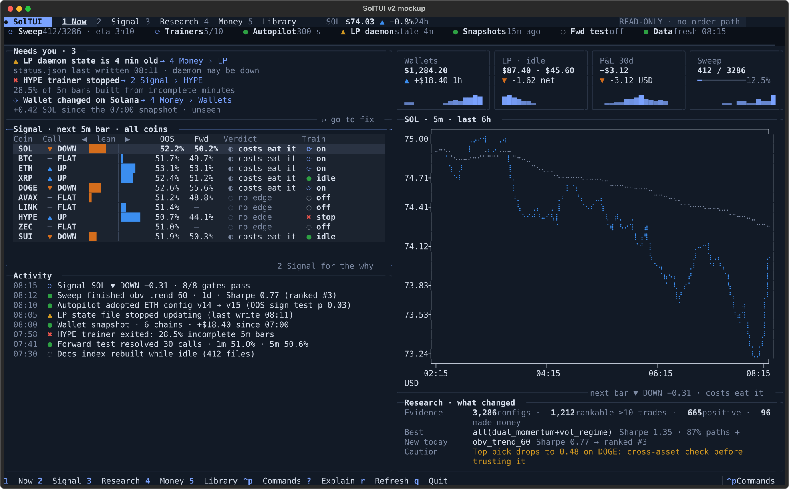
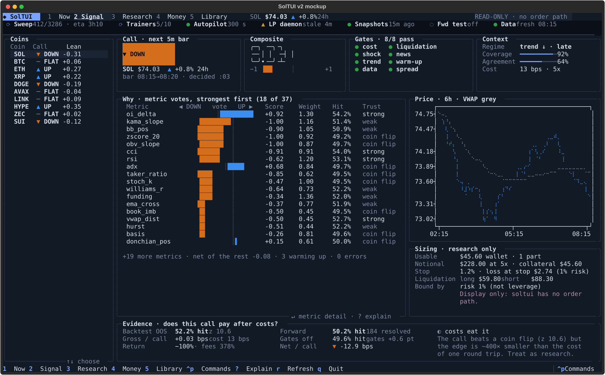
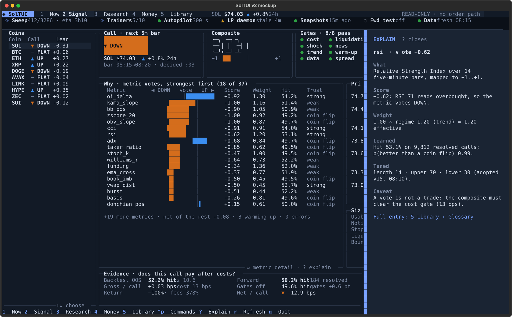
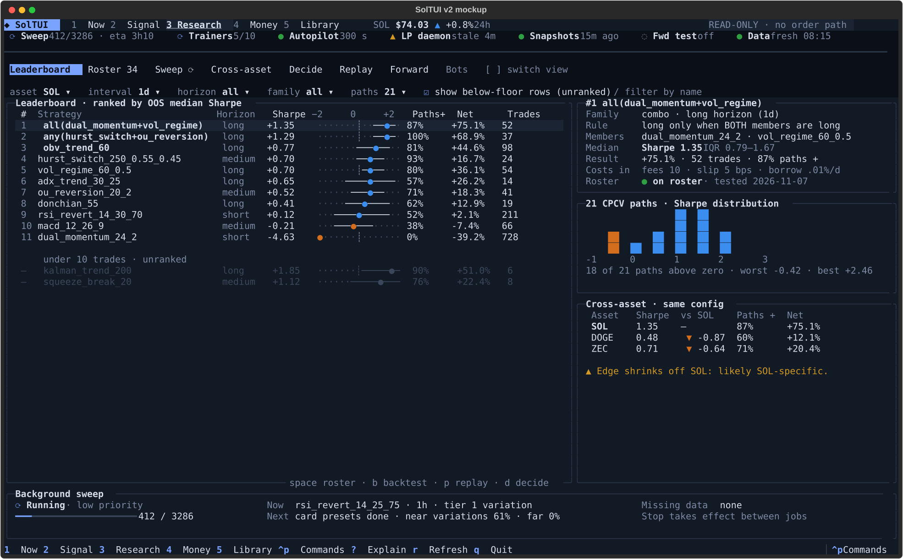
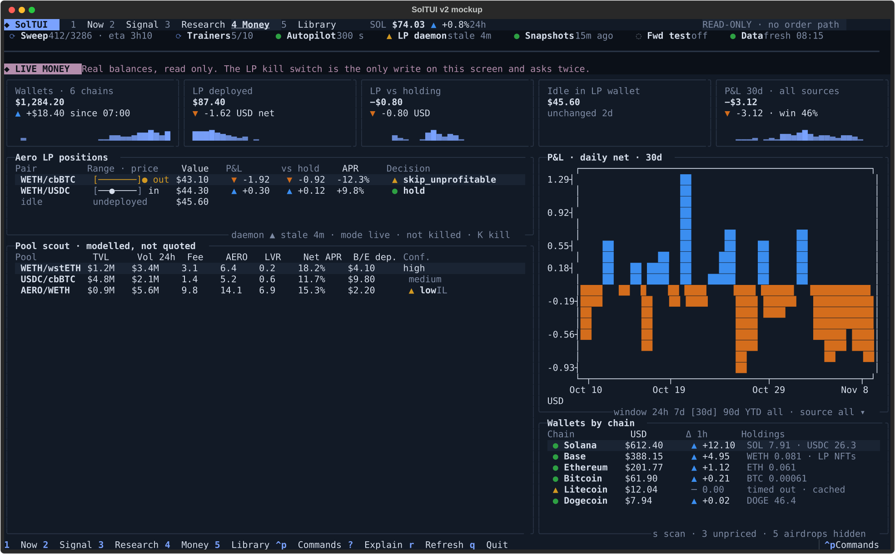
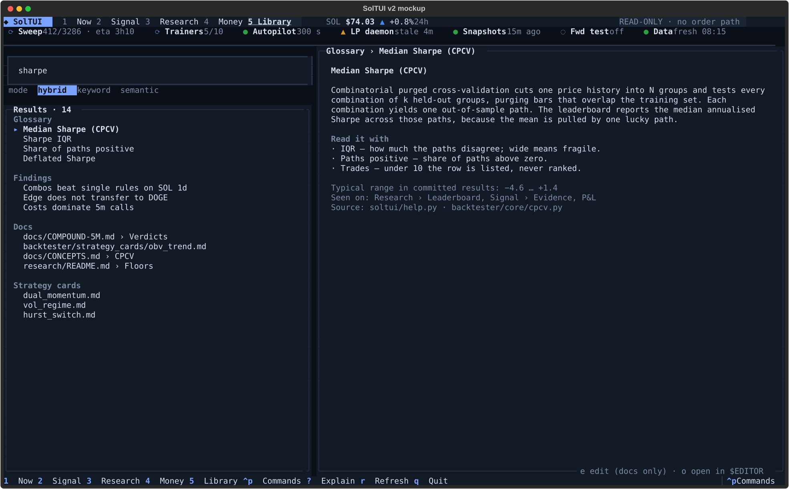
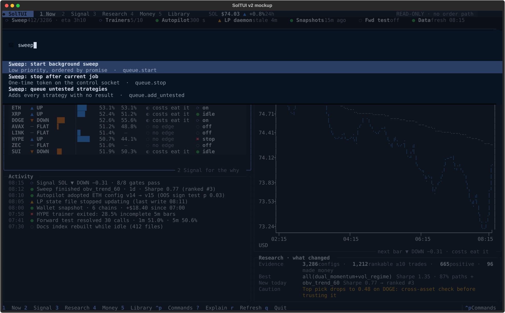

# SolTUI v2: a layout-blind redesign

Status: **implemented** in `soltui/` (Stele TASK-904). The clickable mockup below remains the
reference. Proposal: TASK-877, decision KNOW-878. The classic console is preserved as the git tag
`soltui-ui-v1` (branch `backup/soltui-ui-v1`), and `soltui --classic` shows its tab bar.

## 0. What shipped, and where it differs from the mockup

- **Shell** (`soltui/shell.py`, wired in `soltui/tui.py`):
  - the five destinations plus Settings (`,`), with sub-view rows and `[` `]` cycling;
  - the top bar with the live SOL price from the recorder;
  - the health strip (a 5 s registry read);
  - the LIVE MONEY band on Money;
  - `?` Explain on an overlay layer;
  - the `ctrl+p` registry palette;
  - the soltui-night theme.
- **Every classic pane is kept.** The classic tab bar is hidden and its single TabbedContent drives
  the panes, so every pane, id, button and test is unchanged. `test_v2_shell` asserts that every
  pane is reachable, and a pane added later is filed under Research automatically.
- **Now is new.** It shows:
  - Needs you, built from the registry status reads;
  - every coin (`compound.overview`);
  - the wallet, LP, sweep and SOL-forward tiles;
  - activity: adoptions, sweep results and wallet scans;
  - the research headline;
  - live prices.
- **Signal** gains a hero above Call & metrics: the call badge, the composite bar, gates and context.
- **Differences from the mockup:**
  - `r` keeps its classic meaning (run backtest), not refresh.
  - Research has eleven sub-views, because Bots, Replay (Execute), Dry run (Live Run) and
    Indicators (Signals) are classic tabs too.
  - Explain shows the existing F1 help text.
  - The pane interiors are the classic ones under the new theme. The mockup's IQR strips on the
    leaderboard and diverging vote bars in the metric table are not built yet.
- **Narrow terminals keep their bearings.** When a navigation row does not fit, the top bar keeps
  the no-order-path badge and the sub-view row shows the selected view with clickable previous/next
  controls. All panes remain reachable by keyboard. Pane interiors retain their classic sizing.
- **The palette never runs a write.** Only read-only commands with no required parameters run from
  it; every other command opens and focuses the button that owns it.

This is the owner's read-only research console (`soltui/`) redesigned from its functions, not from
its screens. The designer never looked at the current layout. A read-only subagent listed what the
tool does and what data it shows, and was told not to report panels, tabs, keys or styling. The
design here comes from that list, the dataviz and frontend/UI skills, and the project's honesty rules.

Run the mockup (Textual 8.2.8 and textual-plotext; it imports nothing from `soltui/`):

```bash
python3 -m venv /tmp/soltui-mock && /tmp/soltui-mock/bin/pip install "textual==8.2.8" textual-plotext
/tmp/soltui-mock/bin/python docs/design/soltui-v2/mockup.py                   # interactive
/tmp/soltui-mock/bin/python docs/design/soltui-v2/mockup.py --shots docs/design/soltui-v2/screens
```

Every number in the mockup is a fixture. Most come from committed result files, cited in section 9.

---

## 1. What SolTUI does: the primary functions

1. **Health at a glance.** Show the state of every background process: sweep worker, compound
   trainers, autopilot, Aero LP daemon, wallet snapshots, minute forward test, price data.
2. **Five-minute market call.** Give an UP / DOWN / FLAT call for the next 5m bar per coin, with every
   metric's vote, the gates, regime, coverage and agreement.
3. **Prove or disprove the call.** Show compound backtest (in-sample and out-of-sample hit, z, gross bps
   against 13 bps cost, verdict), the forward ledger, and per-metric learned hit rates.
4. **Size a call for research.** Show usable USD, notional at 5x, stop, loss at stop and liquidation
   prices. Display only: soltui has no order path.
5. **Tune and train the compound.** Turn metrics on or off and set weights, parameters, blackouts and
   scope. Run unattended trainers and the autopilot that adopts configs out of sample.
6. **Rank strategies honestly.** Show CPCV backtests ranked by out-of-sample median Sharpe, with IQR,
   share of paths positive, net % and trades. Rows under 10 trades are listed, never ranked.
7. **Run the research.** Run the foreground CPCV, the low-priority background sweep and its queue, and
   the missing-data fetch.
8. **Curate the roster.** Add, remove, toggle and reset strategies. Set parameter defaults.
9. **Check that an edge transfers.** Show the Top 5 configurations across SOL, DOGE and ZEC.
10. **Ask "what would each strategy do now?"** Run a point-in-time decision across all strategies.
11. **Rehearse.** Replay a backtest bar by bar, launch the extension dry run, and run the minute
    forward test at 1, 5, 10 and 30 minutes.
12. **Watch real money (read only).** Show Aero LP positions and range, P&L against holding, the pool
    scout, experiments and actions, and the kill switch (the one real-money write).
13. **Account for P&L.** Show P&L by window (24h to all) and source (backtest, paper, dry run, LP,
    wallet), with drawdown, win rate and expectancy.
14. **Know the wallets.** Run read-only scans of six chains, hourly snapshots and change notices, with
    airdrop tokens filtered out and unpriced tokens named.
15. **Look things up.** Search docs, the glossary and research findings; edit docs.
16. **Reach every action from any surface.** One command registry serves the TUI, CLI, HTTP API,
    native host, browser view and menu bar.

## 2. The questions the owner brings, and where each one lands

The current tool is organised as many peer tabs. The redesign groups by the question in the owner's
head. Each question gets one destination, one number key and one first glance.

| Key | Destination | The question it answers in under 5 seconds | Functions |
|---|---|---|---|
| `1` | **Now** | Does anything need me? | 1, glimpses of 2, 6, 12, 13 |
| `2` | **Signal** | What is the next 5m call, why, and does it pay after costs? | 2, 3, 4, 5 |
| `3` | **Research** | Which strategies actually work, and how sure are we? | 6–11 |
| `4` | **Money** | What is my real money doing? | 12, 13, 14 |
| `5` | **Library** | What does this word or number mean? | 15 |
| `ctrl+p` | **Commands** | Do X, from anywhere | 16 (the registry, by name) |
| `?` | **Explain** | What is the focused number? | definitions for every field |

Research holds its seven tools as sub-views (`[` `]` cycles): Leaderboard, Roster, Sweep, Cross-asset,
Decide, Replay, Forward. A Bots sub-view is reserved for the in-flight Bots work (TASK-870), so it
lands without another top-level tab. Settings (asset, costs, CPCV split, wallets, xpubs, parameter
defaults) open as a sheet from the palette. Settings are not a destination, because the owner
visits them rarely.

## 3. The chrome that never moves

Three bands frame every screen.

- **Top bar:** destinations with their number keys, SOL price and 24h change, a permanent
  `READ-ONLY · no order path` badge, and the clock.
- **Health strip:** every background process as glyph + name + one fact (`⟳ Sweep 412/3286 · eta 3h10`,
  `▲ LP daemon stale 4m`). The owner never navigates to learn whether something died. Each item is
  focusable and jumps to its owner view.
- **Footer:** the keys that work right now.

## 4. Screens

### 1 Now: "Does anything need me?"



- **Needs you** comes first, worst first: stale, failed or unseen items. Each carries the fact that
  makes it actionable and a jump target. An empty list reads "All clear". That empty list is the goal.
- **All coins on one table:** the call, the lean as a diverging bar, OOS and forward hit rates, the
  verdict and trainer state. Ten rows can be scanned top to bottom.
- **Stat tiles** carry one number each, plus its change and a sparkline (dataviz: "the number is the
  chart").
- **Research · what changed** includes a *Caution* line when the best result fails cross-asset. The
  good news does not travel without its caveat.

### 2 Signal: "What is the call, why, and does it pay?"



- **Reading order matches decision order:** call → strength (composite digits and scale) → gates →
  context. Then *why* (votes), then *does it pay* (evidence). The call is a three-row block because it
  is the answer.
- **Why** is a diverging bar per metric, sorted by contribution. Weight, learned hit and a plain
  *trust* word (strong / weak / coin flip) sit beside each bar. A strong vote from a coin-flip
  metric becomes visible at a glance.
- **Evidence answers the only question that matters.** The verdict uses the tool's own vocabulary
  (`possible edge` / `costs eat it` / `no edge`) and states the gap in plain words: "the edge is ~400×
  smaller than the cost of one round trip".
- **Sizing** stays labelled *research only*, with a line in the reserved "live" colour: display only,
  no order path.



`?` opens **Explain** for the focused field. It shows what the field is, how this value was computed,
how far to trust it, and a link to the full glossary entry. The drawer floats on an overlay layer, so
opening it never reflows the screen under it.

### 3 Research: "What works, and how sure are we?"



- **One filter row above everything it scopes** (asset, interval, horizon, family, paths, show
  below-floor). There are no per-panel filters.
- **The IQR strip:** a one-line box plot per row. The rule spans the IQR, the dot is the median and
  the tick marks zero. A reader sees spread and sign without reading two numbers.
- **The floor is visible, not hidden.** Rows under 10 trades sit below a divider, dimmed and
  unranked. `kalman_trend_200`'s +1.85 Sharpe on 6 trades cannot outrank anything (KNOW-678).
- **The detail pane** gives the rule, the members, the costs that went in, a path histogram whose
  negative bins are drawn in the down colour, and **cross-asset** with a warning when the edge shrinks
  off SOL.
- The **sweep** stays docked at the bottom with its phase, progress, current job and how stop behaves.

### 4 Money: "What is my real money doing?"



- A **LIVE MONEY** band in a hue reserved for real money. Research screens never use that hue, so the
  owner can tell from peripheral vision which screen touches real balances.
- **LP range cells** (`[──●──] in` / `[───────]● out`) answer "in range?" without arithmetic.
- **P&L against holding** sits next to raw P&L, because a pool that earns fees can still lose to
  holding.
- **The pool scout** is titled *modelled, not quoted*, matching extension rule 8.
- **The kill switch** shows its state in the LP card subtitle (`daemon ▲ stale 4m · mode live · not
  killed · K kill`). It asks twice and is the only write on the screen.
- **Wallets by chain** show a partial scan as `▲ partial` with the reason. Unpriced tokens and
  hidden airdrops are counted in the subtitle, never silently dropped.

### 5 Library: "What does this mean?"



One search box covers the glossary, findings, docs and strategy cards, grouped by kind, with
keyword / semantic / hybrid modes. The reader explains, gives the typical range, says where the
number appears ("Seen on") and names its source code.

### Command palette



`ctrl+p` searches the whole registry by verb ("Sweep: start…", "LP: kill daemon"). Each entry shows
a one-line description and the registry command it calls (`queue.start`). The palette is how SolTUI
keeps non-negotiable 6 ("three surfaces, one registry") visible in the UI. A command gets a key only
when it is used daily.

## 5. Visual and data rules

These rules carry the design from screen to screen.

1. **Colour has jobs, and only four of them.**
   - *Diverging* (`up #3b8ef0` / `down #d46d1c`): every signed quantity (calls, votes, P&L, deltas).
     Blue and orange, not green and red. The pair passed the dataviz validator on the dark surface:
     lightness band, chroma, CVD ΔE 28.4, normal-vision ΔE 31.6, contrast ≥3:1.
   - *Status* (`ok`, `warn`, `err`, `run`, `idle`): system health only.
   - *Accent*: focus and navigation.
   - *Live*: real money only.
2. **No colour carries meaning alone.** Status always pairs with a glyph whose shape differs
   (`● ▲ ✖ ⟳ ◌`) and a word. The validator measured green and amber at ΔE 4.4 under protanopia, so
   the glyph is required, not decoration. Direction always has `▲ ▼ ─`.
3. **Numbers stay in ink. Glyphs carry the colour.** `▼ −1.62` colours the triangle, not the digits.
4. **Right-align every number column. Units go in the header or the title, not in every cell.**
5. **Choose the form by the data's job** (dataviz `choosing-a-form`):

   | Data | Form |
   |---|---|
   | Single values | stat tile |
   | Signed contributions | diverging bar |
   | Distributions | box strip or histogram |
   | Progress | meter |
   | Price over time | braille line with VWAP in grey |
   | Daily P&L | diverging bars |

   Every chart has a table twin: its numbers sit in the row beside it.
6. **Stale data dims and shows its age. It never blanks.** "Hold the previous render" applies to
   every view. A source older than its freshness budget raises a *Needs you* item and turns its
   health-strip glyph to `▲`.
7. **Honesty is a layout rule.**
   - A verdict sits next to every hit rate.
   - The cost appears beside the gross edge.
   - Below-floor rows are unranked.
   - A cross-asset caveat travels with the top pick.
   - "Modelled" is never shown as "quoted".
8. **Density by default, with the detail one key away.**
   - List → detail → drill (`↵`).
   - Show the top N and fold the rest into a single line ("+19 more metrics · net −0.08").

## 6. Interaction model

| Key | Action | Key | Action |
|---|---|---|---|
| `1`–`5` | Go to destination | `ctrl+p` | Command palette (every registry command) |
| `?` | Explain focused field | `/` | Filter the focused list |
| `↑↓` `↵` | Move, open detail | `[` `]` | Previous / next sub-view |
| `space` | Toggle roster membership | `r` | Re-read sources |
| `c` | Switch coin (Signal) | `K` | LP kill (asks twice) |
| `esc` | Back out one level | `q` | Quit |

Mouse works everywhere Textual supports it. Nothing needs it.

The mockup wires `1`–`5`, `?`, `ctrl+p`, `r`, `q` and `↑↓` on the Signal coin rail. The other keys in
this table are specified here but not wired in the mockup.

**Size.** The design targets 160×48 (a full-screen 14" terminal). Below 120 columns, the Signal coin
rail collapses into the `c` switcher. The Research detail pane becomes a `↵` sheet, and the Now
columns stack. The mockup implements only the 160×48 layout.

## 7. Empty, stale and error states

| Surface | State | What the owner sees |
|---|---|---|
| Any source | Older than its budget | Value dimmed, age shown, `▲` in the health strip, a *Needs you* item |
| Price data | Missing | "No data for SOL 1h. Run Data: fetch missing series" (palette entry) |
| Compound backtest | None yet | "No backtest yet" and a palette suggestion. Never a zero |
| Metric | Warming up / error | Counted in the fold line ("3 warming up · 0 errors") |
| LP state | Older than 180 s or corrupt | `▲ LP daemon stale 4m`, the card subtitle says why |
| Wallet scan | Partial | `▲ partial` row with the endpoint's reason; total excludes it and says so |
| P&L | Window outside the data | "No data inside 7d; the source covers Oct 2–Oct 30" |
| Search | Semantic unavailable | Falls back to keyword and says why in the mode line |

## 8. Why Textual, and what else was considered

The mockup uses **Textual 8.2.8** with **textual-plotext** for the braille charts. Textual is already
soltui's runtime, so the mockup's widgets, CSS and theme map one-to-one onto a real migration. It
ships DataTable, Sparkline, Digits, layers, a command palette with custom providers, headless
`run_test()` and SVG screenshots. textual-serve can also show the same app in a browser.

The other options considered were **Ratatui** (Rust) and **Bubble Tea with Lip Gloss** (Go). Both
render faster but would add a second language to a Python component. Render speed does not limit a
console that refreshes every few seconds.

## 9. Where the fixture numbers come from

| Fixture | Source |
|---|---|
| CPCV rows | `research/results/cpcv_results.csv` |
| Top 5 combos and cross-asset | `research/results/cpcv_top5_sol_doge_zec_1d.csv` |
| Compound OOS hit and z (SOL, BTC, ETH, HYPE), fees 378%, return −100% | `research/results/compound-10coin-fullhistory-2026-11-07.json` |
| Forward hit rates (SOL 50.2%, DOGE 55.6%) | `docs/COMPOUND-5M.md` |
| LP position, scout pool, idle $45.60 | `liquidity/STATE_FILES.md` example data |
| Cumulative headline (3,286 / 1,212 / 665 / 96) | committed result files, summarised by soltui's cumulative view |

Other values are invented to look like these: other coins' prices, wallet balances, activity times
and the metric votes.

## 10. Validation done

- `mockup.py --shots` renders all 7 screens at 160×48 headlessly with no exception.
- An interaction smoke run (Textual pilot) covered all five destinations by key, rail selection
  updating the hero to ETH, the `?` toggle, and the palette's "Go to Money".
- Three critique passes were applied:
  1. Fit table widths, and keep glyph colour under the cursor (`cursor_foreground_priority="renderable"`).
  2. Make the call outweigh the digits.
  3. Move Explain to an overlay layer so it stops reflowing the screen.
- The palette was validated by the dataviz validator (section 5).

## 11. Moving soltui toward this

The mockup only proposes; this order would move soltui toward it without a rewrite.

1. Add the health strip and the *Needs you* list over the existing views. They need only the status
   reads soltui already has.
2. Register the palette provider over `commands.py`, so every action is reachable by name.
3. Add the Explain overlay over `help.py`, the existing glossary.
4. Fold tabs into the five destinations one at a time: Signal first (the compound views), then
   Research sub-views, then Money.

Each step is independently shippable and keeps every data surface the current tool has.
