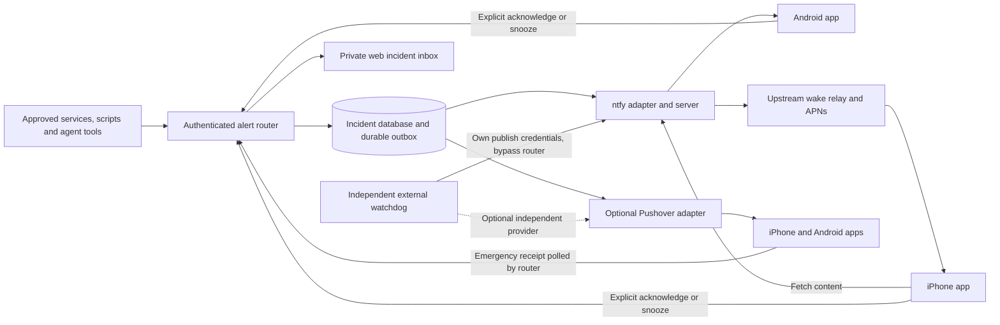

# Mobile push alerts we control

Version: 1.0.1
Delta: clarify independent hosting, provider cancellation, actor attribution, event ordering and shared account quota after independent review.
Source check: 2026-11-11.
Status: design only; no server, phone enrollment, purchase or live notification was deployed.

## Recommendation

Own the alert rules, incident history, acknowledgments and escalation. Use
**self-hosted ntfy** as the first delivery adapter because it has native iPhone
and Android apps and a simple HTTP publishing interface. Keep **Pushover** as an
optional adapter for urgent alerts that need built-in repetition and explicit
acknowledgment. Start with one adapter; do not build two mobile apps first.

This replaces the parts of PagerDuty we actually need without tying the incident
database to a delivery vendor. It does not establish emergency-service reliability.

| Choice | iPhone and Android | Ownership and cost | Main constraint |
| --- | --- | --- | --- |
| Self-hosted ntfy | Native apps on both | Open-source server; our hosting, topics, credentials and retention | Timely stock iOS background delivery needs an upstream wake relay; we build incident acknowledgment and escalation |
| Pushover | Native apps on both | Hosted delivery; individual license currently USD 4.99 once per platform, including multiple devices on that platform; 10,000 messages per account per month shared across its applications | Provider dependency and quotas; emergency repetition ends on acknowledgment or expiry |
| Gotify | Official Android app and web UI | Self-hosted open-source server | Official sources do not list an official iOS app; poor default for this mixed fleet |
| Our own apps | Possible on both | Full app and backend maintenance | Still uses APNs on iPhone; Critical Alerts require Apple's special entitlement and user permission |

Pushover is the shortest route if urgent paging is the first requirement. ntfy is
the preferred starting point if controlling the service is the first requirement.
Neither supplies our complete incident workflow automatically.

## The iPhone constraint

Self-hosting the server does not remove Apple's background delivery rules. The
stock ntfy iOS app uses an APNs-connected upstream to wake the phone. ntfy's
documented configuration is `upstream-base-url: https://ntfy.sh`.

Our server forwards a message ID and SHA256 of the topic URL. The upstream does
not receive the actual message body in this flow. The iPhone then retrieves the
body from our server. This still exposes timing and routing metadata; it is not
zero third-party involvement. Without the upstream, ntfy documents delays of hours.

A Tailscale-only ntfy server is a candidate deployment, not a proven pager. The
phone must reach it while locked and on cellular to retrieve the content. If it
cannot, ntfy may display only **New message**. A wake notification does not prove
VPN reconnection or successful content retrieval. A public, authenticated HTTPS
endpoint could remove that VPN dependency, but would be a separate deployment
decision. Keep the existing MCP endpoint private.

For our own iOS app, use visible push notifications for alerts. Do not depend on
silent background polling: Apple documents background pushes as throttled and
not guaranteed. FCM on iOS still routes through APNs. Priority alone does not
guarantee sound through Focus or mute. Prove behavior with the chosen app's actual
permissions and phone settings; Pushover documents an iOS Critical Alerts option.

## Proposed architecture

Use one small service with SQLite and a persistent outbox first. For the proposed
pilot, put the router, ntfy and watchdog on a separate always-on computer or small
Linux VPS; the monitored Mac is only a producer. The watchdog has its own state
and publish credentials and can publish directly to ntfy if the router is down.
This gives the single-adapter pilot a path for Mac outages. A Mac-only launchd
preview is useful for development but does not meet that acceptance criterion.
Keep producer and administrative access private through Tailscale. Separate
publish, subscribe and operator credentials. Back up state and document restore
behavior. Monitoring the separate alert host itself requires a further external
probe and a delivery path that does not depend on that host.

The first version needs an inbox with open/resolved incidents, severity, last
observation, **Acknowledge**, **Snooze** and **Open details**. Phones receive short
messages such as “M5: collector heartbeat is stale” and a link to the private
details. Routine messages can have quiet hours; urgent escalation follows a
separately configured policy. Default to one recipient group and explicit opt-in.

## Incident and delivery rules

- Persist each event and its outbox rows in one transaction before accepting it.
  Authenticate the producer and bind it to allowed sources, recipients and maximum
  severity. Deduplicate the event ID within that source. Refuse reuse of an event
  ID with different content. Bound payloads, queues and per-source rate.
- Track source lifecycle (`open` or `resolved`) separately from operator response
  (`unacknowledged`, `acknowledged`, or `snoozed` until a deadline). Acknowledgment
  stops paging for the configured audience; it does not fix the fault, claim a
  source case, trade, restart a service or change the source system.
- Give each recurrence a new episode ID. A resolved episode is terminal: an old
  trigger cannot reopen it. Require a monotonic source revision within an episode;
  ignore already accepted revisions and reject conflicting content at the same
  revision. Do not use producer wall-clock time to order state changes.
  Collapse repeated observations into one
  open incident with an occurrence count. A severity increase or material new
  episode can require a new acknowledgment. A failed or incomplete source read
  must not resolve an incident; produce a separate visibility alert.
- Record provider acceptance, explicit acknowledgment, expiry and failure as
  different facts. An HTTP 200, APNs acceptance or provider receipt does not prove
  the phone displayed a message or a human read it. Restart recovery must retain
  pending events, acknowledgment state and escalation deadlines.
- Use bounded retries with backoff for delivery failures. Preserve incident
  ordering, reject obsolete scheduled repeats, expose dead letters and queue age,
  and cap alert storms. External provider sends are at least once: a timeout after
  acceptance can cause duplicates. Do not promise exactly-once phone delivery.
- Suggested pilot policy: send immediately; remind after two minutes if still
  unacknowledged; escalate after five minutes to an explicitly enrolled second
  recipient or channel. These are proposed defaults, not current configuration.
  Do not treat a second app on the same phone as an independent fallback for a
  phone with no connectivity.

With ntfy, our router owns reminder scheduling. Official ntfy docs list HTTP
action buttons on iOS and Android, so **Acknowledge** can POST to our service.
Use an expiring, incident-and-recipient-scoped capability rather than embedding
an administrator credential. Store its hash, audit its use and make repeated
acknowledgments idempotent. A capability distributed through a group topic proves
only possession of that group capability: record a group acknowledgment, not an
invented individual actor. Use per-user deliveries or authenticated inbox login
when individual attribution is required. A fetched link must never acknowledge
automatically; web pages require an explicit authenticated action. Phone actions
need actual cross-platform testing, including expired credentials and lost
private access.

Pushover emergency priority `2` requires `retry` of at least 30 seconds and
`expire` of at most 10,800 seconds. Persist its receipt and poll its status over
outbound HTTPS, so our router needs no public callback endpoint. A group message's
first acknowledgment stops retries for the entire group. Use separate deliveries
when individual accountability is required. Local acknowledgment, snooze and
resolution must cancel every active provider receipt for that paging scope.
Persist cancellation in the outbox and retry failures; show **cancellation pending**
or **cancellation failed** rather than claiming the phone has stopped ringing.
On snooze expiry, create a new delivery if the incident is still open and has no
acknowledgment. If provider expiry arrives without acknowledgment, record that
condition and apply our escalation policy. Current Pushover API docs also support optional
end-to-end encryption on iOS and Android; enrollment and usable client versions
would need verification before relying on it.

## Proposed API and existing integration points

These routes are a proposed contract, not implemented endpoints:

| Operation | Contract |
| --- | --- |
| `POST /v1/events` | Producer bearer credential; `schema_version`, `event_id`, `source`, `incident_key`, `episode_id`, monotonic `source_revision`, `transition` (`trigger`, `update`, `resolve`), `severity`, `observed_at`, short `summary` and an allowlisted `details_url`. Return HTTP 202 and `{"accepted":true,"event_id":"..."}` only after durable acceptance. Identical retries return the same result; conflicting reuse returns 409. Stale revisions cannot change state; a resolved episode is terminal. |
| `GET /v1/incidents` | Operator/subscriber authentication; bounded cursor pagination with visible source freshness and response state. No secrets or raw source evidence in the response. |
| `POST /v1/incidents/{id}/acknowledgments` | Explicit operator authentication or narrowly scoped phone-action capability; idempotent audited state change. |
| `POST /v1/incidents/{id}/snoozes` | Explicit operator authentication; bounded expiry and recipient scope. Snooze does not change source lifecycle. |
| `POST /v1/heartbeats` | Producer authentication; server receipt time controls freshness so a producer timestamp cannot extend its own health indefinitely. |

The router implements authentication, actor attribution, policy, retention and
audit once. Its adapters translate to ntfy or Pushover. Keep source adapters and
push adapters separate so a vendor change does not require rewriting monitors.
An optional MCP tool can submit to the same contract later, with allowed recipients,
rate limits and an audited severity policy; agent text must not bypass those rules.

Verified existing sources that could feed this later:

- `/Users/mitch/dev/solmargintrader/botmanager/src/botmanager/health_commands.py`
  exposes the read-only `alerts` command with `after` and `limit`.
  `/Users/mitch/dev/solmargintrader/botmanager/src/botmanager/health.py` returns
  attributable alert rows, `next_after` and `has_more`. An adapter can checkpoint
  this cursor only after durable router acceptance. The adapter must persist its
  mapping to incident episodes and source revisions. This is a projection, not a
  guarantee of an immutable event stream or phone delivery.
- `/Users/mitch/dev/esre-chrome-plugin/docs/independent-watcher.md` already
  documents an optional watcher webhook with `esre-p1-event-v1`, stable
  `deliveryId`, an `Idempotency-Key`, trigger/resolve ordering and explicit durable
  `{"accepted":true}`. A future adapter should translate that existing contract,
  not silently redefine it. Its existing schema does not supply our new
  `source_revision`: the adapter must persist ordering from the watcher's ordered
  deliveries and deduplicate retries before assigning a revision. No production watcher enrollment was established by
  this research. Keep its source access, recipients and alert activation opt-in.

The existing shared-relay decision, **KNOW-1321**, excludes private customers,
private watch histories, assistant data and local alert controls from shared
evidence. This design preserves that boundary. Default push content should omit
customer text, credentials and sensitive operational evidence. Review even a
generic alert's routing metadata before selecting a hosted delivery path.

## Detecting failure of the alert system

A Mac cannot notify us after it loses power or internet. A watchdog in another
failure domain must expect a heartbeat and generate an outage alert itself. It
must also detect a stopped router, stale source readings and an aging outbox.
Give it its own delivery credentials and state; it must not call the failed Mac
to send its alert. An optional separately configured SMS/voice service can later
cover urgent cases where phone push remains unacknowledged. ntfy's iOS wake relay
and Pushover both ultimately depend on Apple's infrastructure for an iPhone;
using both does not remove that shared dependency.

## Acceptance before using this as a pager

1. Enroll one iPhone and one Android with dedicated test credentials. Verify auth,
   topic isolation and an ordinary synthetic notification without private evidence.
2. With each phone locked and on cellular, verify notification display, content,
   sound and time to acknowledgment. Repeat after prolonged idle, battery saving,
   app/phone restart, and Tailscale loss/reconnection. Test Focus/mute permissions
   explicitly. Do not claim guaranteed timing from provider documentation.
3. Verify acknowledge and snooze on both apps; duplicates, expired action tokens,
   unauthorized actors, offline actions and source resolution must have visible,
   correct results. Opening a notification alone must not acknowledge it.
4. Crash the router before and after provider acceptance. Verify durable outbox
   recovery, bounded duplicate behavior, correct ordering, no stale repeat after
   acknowledgment/resolution and one new page for a genuinely reopened episode.
5. Stop the monitored Mac and disconnect its network. The external watchdog must
   page independently. Test provider failure/quota exhaustion, an outbox backlog
   and restoration from backup. Record observed phone behavior and actual failures.

No claim in this document establishes those phone or outage tests as passed.

## Primary sources and research limits

Primary documentation was checked on the source-check date. Context7 supplied
current ntfy and Pushover documentation. Orbit API discovery returned HTTP 403;
provider conclusions use the primary sources below. Postman resource discovery
was skipped because the local CLI has no signed-in account. This design requires
no Postman account, collection, deployment or live provider credentials.

- ntfy phone apps: https://docs.ntfy.sh/subscribe/phone/
- ntfy self-hosted iOS wake flow: https://docs.ntfy.sh/config/#ios-instant-notifications
- ntfy HTTP action support: https://docs.ntfy.sh/publish/#send-http-request
- Pushover pricing: https://pushover.net/pricing
- Pushover emergency priority: https://pushover.net/api#priority
- Pushover receipt and cancellation behavior: https://pushover.net/api/receipts
- Pushover optional E2EE: https://pushover.net/api#e2ee
- Pushover iOS Critical Alerts setting: https://support.pushover.net/i234-override-silent-on-iphone/1
- Gotify official clients: https://gotify.net/
- Apple APNs delivery: https://developer.apple.com/documentation/usernotifications/sending-notification-requests-to-apns
- Apple background limits: https://developer.apple.com/documentation/usernotifications/pushing-background-updates-to-your-app
- Apple Critical Alerts: https://developer.apple.com/documentation/usernotifications/unauthorizationoptions/criticalalert
- FCM iOS APNs integration: https://firebase.google.com/docs/cloud-messaging/cpp/get-started
- Android high-priority delivery: https://firebase.google.com/docs/cloud-messaging/android-message-priority
