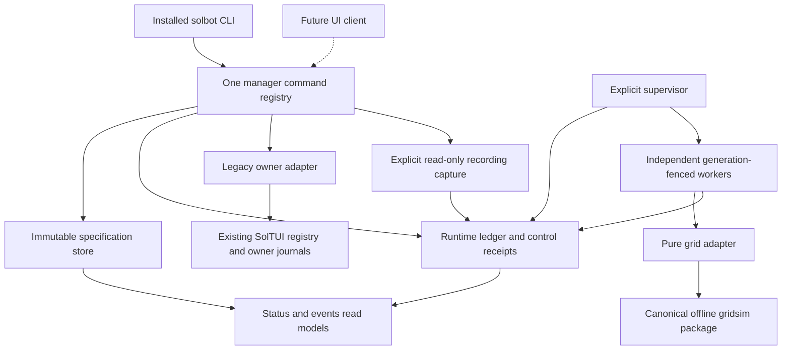

# Standalone Solbot manager: implementation and operations handoff

- Version: 1.0.0
- Delta: Initial complete handoff of the approved design and delivered milestones 1 and 2.
- Reviewed: 2026-11-09, America/New_York. Runtime observations are a snapshot, not a monitoring feed.
- Product baseline: remote master commit `2810f4b23cbd7842dcf03924608e7cb758836ee8`.

Maintainer: repository owner and the agent implementing the next approved milestone. Review this document whenever a command, schema, execution capability or installed package changes.

The standalone application is installed as `solbot`. It saves immutable named bot specifications, discovers an existing SolTUI owner, delegates guarded legacy controls when that owner supports them, and supervises independent grid accounts against a bounded recorded Coinbase input. It defaults to paper and disarmed. Milestones 1 and 2 are delivered. Prospective Jupiter trading, the other new strategy runtimes, blind selection, learning, graphical integration and live execution remain later work.

This handoff is for the operator using the installed tool and the developer continuing it. It records what this session built, why it chose these boundaries, where the authoritative code and evidence live, and how to inspect, maintain and recover the application. Source references below use the canonical repository path; verify the actual checkout revision before editing or reinstalling.

## 1. Access and current state

### Installed entry points

| Item | Path or value | Meaning |
| --- | --- | --- |
| Convenient command | `/Users/mitch/.local/bin/solbot` | Symlink to the stable console script |
| Stable console script | `/Users/mitch/.venvs/solbot/bin/solbot` | Runs the regular, noneditable installation |
| Stable Python | `/Users/mitch/.venvs/solbot/bin/python` | Interpreter and packages used by the console script and service |
| Manager distribution | `solbot-manager==0.2.0` | CLI, specifications, owner adapter and reference runtime |
| Shared distribution | `solmargintrader-backtester==0.1.0` | Existing canonical offline simulation code |
| Installed numeric dependencies | NumPy `2.5.4`, pandas `3.1.1` | Observed versions in the accepted environment |
| Default data home | `/Users/mitch/.config/solbot` | Selected by the actual user's home; override with `SOLBOT_HOME` |
| Canonical source | `/Users/mitch/dev/solmargintrader/botmanager` | Permanent repository layout |
| Continuation checkout | `/Users/mitch/dev/solmargintrader-wt-01a1c189` | Private worktree used for this implementation and its recovery ledger |

The installed command works from outside the repository without `PYTHONPATH`. Run these read-only commands:

```sh
/Users/mitch/.local/bin/solbot --help
/Users/mitch/.local/bin/solbot help
/Users/mitch/.local/bin/solbot list
/Users/mitch/.local/bin/solbot service status
/Users/mitch/.local/bin/solbot discover
```

`--help` prints argparse usage. `help` returns the machine-readable command list and strategy capabilities. `list` shows manager-owned specifications; `discover` reports external installations. They are different inventories.

At handoff verification, the default manager home was absent. `service status` returned `installed=false`, `definition_present=false`, `supervisor_lock_held=false` and `automatic_install=false`. No production manager service or bot was started by this session. An absent home is a valid fresh state; read commands leave it absent.

The configured legacy SolTUI endpoint reported `incompatible_owner`, with unknown inventory. Browser inventory reported `registration_required`; Node FileStore reported `discovery_unavailable`. These observations do not mean those sources have zero bots. The tool deliberately refuses to turn unavailable inventory into an empty successful result.

The primary checkout was held by other active sessions and behind the verified release when this handoff began. Do not reinstall from an old checkout merely because its path is canonical. Check `git rev-parse HEAD` and use a clean checkout containing the intended release. Preserve the other sessions' dirty files and services.

## 2. What was delivered and why

### Request and architecture

The owner asked for one durable application rather than another independent script: defaults for easy creation/control, five strategy families, honest backtests, blind parameter judging, forward paper operation, monitoring, learning and diagnostics, with eventual management of SolTUI and extension bots.

The initial prompt was optimized and executed as a design task. The approved design chose a Python application with one command registry, immutable specifications, SQLite journals, one explicit supervisor, independent workers, pure shared simulation and adapters to existing owners. The owner then approved implementation. Delivery proceeds through eight milestones so that useful controls and recovery arrive before research automation or live operation.

The UI control-room findings were incorporated as backend contracts. A future UI consumes manager state and receipts. It must not add another supervisor, recorder, optimizer, signer or strategy implementation.

### Delivery history

| Delivery | Result | Evidence |
| --- | --- | --- |
| PR171 | Optimized request, reviewed manager specification and eight-milestone plan | https://github.com/mithudso/solmargintrader/pull/171 |
| PR172, separate UI work | Supplemental control-room design incorporated into manager identity, state and receipt contracts | https://github.com/mithudso/solmargintrader/pull/172 |
| PR175 | Milestone 1: CLI/defaults/immutable drafts, truthful status, owner discovery and guarded legacy controls | https://github.com/mithudso/solmargintrader/pull/175 |
| PR180 | Milestone 2: persistent concurrent grid reference-paper runtime, stable packaging and explicit launchd lifecycle | https://github.com/mithudso/solmargintrader/pull/180 |

M1 merge: `4a65a06bf0d5968f56ab861deb2d588aefe42f2d`. M2 merge: `2810f4b23cbd7842dcf03924608e7cb758836ee8`. The M2 reviewed product source was `39e0c262d715fe6d9ec2e877a3a9cabdf3eceb9f`; subsequent changes repaired one test fixture and updated release records, without changing accepted runtime modules.

Concurrent historical-data, monitor and signal-research work was preserved during integration. This session did not author or certify all those datasets. Their dedicated handoff is `/Users/mitch/dev/solmargintrader/docs/backtester-history-handoff.md`. The manager uses an explicit recorded-input adapter and does not claim that all repository histories satisfy its execution model.

### Decisions that shape future maintenance

| Decision | Reason | Consequence or cost |
| --- | --- | --- |
| Separate stable bot UUID, configuration revision/hash, runtime ID, owner and generation | A saved strategy is different from one executing session | Copies cannot replace workers or allocate a second funded account implicitly |
| Package canonical backtester code as a local dependency | An installed service cannot rely on a temporary checkout or copied algorithm | Build/install both local distributions together; changes need shared-engine parity checks |
| Keep legacy execution with its current owner | The manager cannot fence clients that ignore its protocol | Older owners remain inspectable but guarded controls refuse until verified capability exists |
| Compare and deduplicate inside the legacy owner | A client GET followed by raw POST has a race and an ambiguous retry window | The owner implements the versioned `bots.manager_control` protocol and durable intent journal |
| Use null with a reason for missing observations | Missing price, fee, heartbeat or P&L is not zero or a successful measurement | Consumers must preserve nullability and separate state dimensions |
| Bind receipts to original acceptance context | Later worker generations must not rewrite the meaning of an earlier command | Schema-1 receipts without provable context retain their IDs/bodies but refuse replay; explicit reconciliation is needed |
| Label Coinbase replay as a reference | A target Jupiter specification cannot certify historical route/fill economics | Reference results remain ineligible for live promotion |
| Keep configuration immutable | Installing new defaults or editing a draft must not silently alter a running account | There is no config-update/adopt/delete/reset command yet; those are explicit future contracts |

## 3. Complete current feature and capability map

| Capability | Delivered behavior | Boundary |
| --- | --- | --- |
| Create named specifications | Stable UUID; case-insensitive unique ASCII name; typed defaults and overrides; immutable saved provenance | Saving starts no worker and reserves no capital |
| Grid | Draft plus independent manager-owned reference-paper replay | One-minute recorded Coinbase inputs only; at most 100 runtime rungs |
| DCA | Typed safety-order specification | New manager runtime unavailable |
| Trend | Typed buffered SMA-crossover specification | New manager runtime unavailable |
| Momentum | Typed trailing-return specification | New manager runtime unavailable |
| Arbitrage | Honest `solana_adapter_unavailable` refusal | No Solana arbitrage adapter or live multi-leg execution |
| Council | External-only identity and available owner status | Not a new manager strategy and not a Jupiter-certified fill model |
| Defaults/provenance | Packaged values, exact-compatible shared values, explicit manual overrides in that order | Shared snapshot injection is currently a Python `CommandContext` interface, not an automatic CLI optimizer importer |
| Multi-instance runtime | Independent grid UUIDs, owners, generations, cursors, lots and virtual accounts | Four desired-running slots; accounts do not share one funded wallet |
| Input registration | Immutable bounded snapshots with source hashes/high-watermarks, costs and engine identity | Does not record new prices or append prospective input |
| Start/stop | Durable idempotent control receipts and generation fencing | Start acceptance is separate from observed running; stop retains exposure |
| State/diagnostics | Separate lifecycle, reachability, heartbeat, data age, evaluation, reason, blockers and next trigger | Full performance-health/alerting/learning reports are later work |
| P&L | Costed reference financials, realized/unrealized values, exposure, checkpointed lots/fills and quote units | No live accounting, deposits/withdrawals reporting or portfolio reconciliation claim |
| Legacy discovery | Read-only owner registry/snapshot adaptation with explicit unknown states | No automatic owner startup or ownership transfer |
| Legacy controls | Expected-session/config guards and durable pending/outcome journals | Real default installed-owner controls were unavailable; HTTP fixtures and owner source tests are separate evidence |
| Browser/Node inventory | Explicit unregistered/unavailable source records | No browser-control or Chrome-local-state discovery implementation |
| Service | Explicit stable-package macOS launchd install/status/uninstall | Foreground daemon works separately; other OS service adapters are absent |
| Pause entries/cancel/close/emergency stop | Separate named capability concepts in status | No corresponding manager CLI operations are implemented |
| Blind optimization/learning | Designed with protected evidence and manual pins | Not delivered or running |
| Live Jupiter execution | Preserved existing executor restrictions | No autonomous live bot is certified by this release |

## 4. CLI and configuration reference

Every application command dispatches through `/Users/mitch/dev/solmargintrader/botmanager/src/botmanager/registry.py`. The parser in `/Users/mitch/dev/solmargintrader/botmanager/src/botmanager/cli.py` only parses, dispatches and renders. Add future commands to the registry, not a second parser-only execution path.

| Syntax after the installed `solbot` executable | Purpose and relevant options |
| --- | --- |
| `--help` | Conventional usage text; exits without state creation |
| `help` | JSON commands, strategy states and current scope |
| `create STRATEGY --name NAME [--set KEY=VALUE ...]` | Save a draft; four supported draft strategies listed above |
| `list` | Manager-owned saved drafts |
| `config BOT [--effective]` | Saved settings, manual overrides, provenance and identity; no mutation |
| `status [BOT] [--why]` | Bot or fleet read model; fleet also reports configured installations |
| `discover` | External installation inventory with completeness/availability reasons |
| `register-input BOT --descriptor ABSOLUTE_JSON_PATH` | Read and pin a compatible recording snapshot; starts no worker |
| `start BOT [--request-id UUID]` | Persist manager running intent; no supervisor required for acceptance |
| `stop BOT [--request-id UUID]` | Persist manager stopped intent and fence commits; retain exposure |
| `start EXTERNAL` / `stop EXTERNAL` with all three guards | Require `--expected-session`, `--expected-config-hash`, `--request-id` |
| `events BOT [--limit 100]` | Read runtime events; this is separate from specification-creation events |
| `daemon` | Explicit foreground supervisor; terminate it with Ctrl-C when operating manually |
| `service status` / `service install` / `service uninstall` | Inspect or explicitly administer the per-home launchd service |

`BOT` accepts a UUID or unique display name. An external identity is such as `soltui-local:grid`. The optional `--effective` flag is accepted for config inspection; the returned saved snapshot already includes effective values. `status --why` supplies an explanation within JSON. There is no compact table, CSV export or all-bots control command in this release.

Ordinary command responses have exactly `schema_version`, `request_id`, `ok`, `data`, `error`. The top-level invocation ID differs from a durable control request ID inside a receipt. Preserve the control receipt's request ID when reconciling a lost response. Exit codes: 0 success, 2 invalid input/identity conflict, 3 unavailable capability/input/owner, 4 operational/store/integrity failure. Errors are sanitized and never repeat arbitrary submitted values.

Per-bot receipts distinguish `acknowledged`, `pending`, `skipped`, `failed` and
`unknown`. Acknowledgment does not prove termination or closed exposure. Unknown
outcomes require reconciliation; they never authorize automatic resubmission.
If a legacy owner has no numeric configuration revision, its receipt uses
`config_revision=null` with
`config_revision_unavailable_reason=owner_does_not_version_configurations` and
binds the separately observed configuration hash. It does not invent revision 1.

### Typed defaults

Common defaults are `mode=paper`, `armed=false`, `venue=jupiter`, `bar_seconds=60`, `capital_usd=1000.0`, `timezone=UTC`, `lot_method=FIFO`, wrapped SOL mint `So11111111111111111111111111111111111111112` and USDC mint `EPjFWdd5AufqSSqeM2qN1xzybapC8G4wEGGkZwyTDt1v`. Only that target mint pair is accepted. Capital is virtual. No observed price, fee, balance, credential or token decimal is fabricated as a default.

| Strategy/version | Parameter defaults | Exact target semantics |
| --- | --- | --- |
| Grid / `grid-ladder-v1` | `range_pct=15.0`, `rungs=7`, `spacing=geom`, `deadband_bps=25.0` | `trigger_ladder`; range is plus/minus range_pct, not total width |
| DCA / `safety-order-v1` | `base_order_usd=100.0`, `safety_order_usd=100.0`, `max_safety_orders=5`, `price_deviation_pct=2.0`, `step_scale=1.0`, `volume_scale=1.0`, `take_profit_pct=2.0`, `stop_loss_pct=0.0`, `cooldown_bars=0`, `min_order_usd=10.0` | `safety_order_ladder`; deals/safety orders, not simple periodic buying |
| Trend / `sma-crossover-v1` | `fast_period=10`, `slow_period=30`, `entry_buffer_bps=10.0` | `next_open` |
| Momentum / `ts-momentum-v1` | `window=60`, `threshold=0.0` | `next_open` |

The constructor baseline is pinned to `78468489cc968e25b87786246a5aa3edf43d2277`; installing newer source does not re-resolve saved drafts. Periods count bars. DCA's 10 USD minimum is a constructor assumption, not a verified Jupiter minimum.

`--set armed=false` retains boolean false; `--set deadband_bps=0` retains numeric zero. Duplicate/unknown keys, wrong types, nonfinite values and unsafe ranges refuse before saving. Non-paper modes and `armed=true` refuse. The draft grid schema accepts up to 500 rungs, while the current bounded runtime admits only 100; a valid draft can therefore remain unrunnable under M2 limits.

Shared values must match strategy ID/version, venue, both mints, bar duration and execution model exactly. Explicit overrides win and become manual pins. Shared adoption cannot alter capital, order sizes, stop-loss/minimum/risk settings or operating mode. There is no automatic live scan of the existing optimizers, experiment stores or learned files.

### Environment and external-owner paths

| Variable | Default/use |
| --- | --- |
| `SOLBOT_HOME` | Defaults to `/Users/mitch/.config/solbot`; isolates all manager journals and service identity |
| `SOLBOT_SOLTUI_ENDPOINT` | `http://127.0.0.1:8788`; numeric IPv4 loopback HTTP only |
| `SOLBOT_SOLTUI_REPO` | `/Users/mitch/dev/solmargintrader`; descriptor candidate, not proof of running source |
| `SOLTUI_PYTHON` | `/Users/mitch/.venvs/soltui/bin/python`; declared existing owner interpreter |
| `SOLTUI_CONFIG_DIR` | `/Users/mitch/.config/soltui`; declared legacy configuration root |
| `SOLTUI_SUPPORT_DIR` | Overrides existing SolTUI support directory used for the API token |

The normal existing token path is `/Users/mitch/Library/Application Support/soltui/api-token`. The manager verifies public health says `service=soltui` before resolving or sending a token. The token must already be a regular owner-owned mode-0600 file. It never creates, repairs or prints credentials. Redirects, proxies and unrelated services receive no bearer token.

## 5. Operator workflows

### Create and inspect without starting work

These examples use a distinct isolated home. They create only saved paper specifications:

```sh
SOLBOT_HOME=/Users/mitch/.local/state/solbot-example /Users/mitch/.local/bin/solbot create grid --name example-grid --set range_pct=10
SOLBOT_HOME=/Users/mitch/.local/state/solbot-example /Users/mitch/.local/bin/solbot create grid --name example-grid-wide --set range_pct=25
SOLBOT_HOME=/Users/mitch/.local/state/solbot-example /Users/mitch/.local/bin/solbot list
SOLBOT_HOME=/Users/mitch/.local/state/solbot-example /Users/mitch/.local/bin/solbot config example-grid --effective
SOLBOT_HOME=/Users/mitch/.local/state/solbot-example /Users/mitch/.local/bin/solbot status example-grid --why
```

Expected: two different UUIDs and manual-pin provenance. A newly created draft has no runtime ID/owner/generation and reports runtime unavailable. No prices are fetched and no capital is reserved. Reusing an existing name refuses rather than updating it. There is no clone/update CLI yet; creating a second name establishes another specification.

### Register a recorded reference input

Create a descriptor at `/Users/mitch/.local/state/solbot-example/reference-input.json` with this body. The historical range was used in actual acceptance; availability must still be checked on the machine. Costs and capital below are illustrative simulation assumptions.

```json
{
  "schema_version": 1,
  "installation_id": "soltui-local-recorder",
  "source": "coinbase_exchange_recorder",
  "paths": ["/Users/mitch/.config/soltui/prices/2026-11-08.jsonl.gz"],
  "product": "SOL-USD",
  "quote_currency": "USD",
  "bar_seconds": 60,
  "start_ts": 1794126060,
  "end_ts": 1794126180,
  "fee_bps": 6.0,
  "slippage_bps": 2.0,
  "carry_bps_per_hour": 0.0,
  "min_order_quote": 10.0,
  "capital_quote": 1000.0
}
```

```sh
SOLBOT_HOME=/Users/mitch/.local/state/solbot-example /Users/mitch/.local/bin/solbot register-input example-grid --descriptor /Users/mitch/.local/state/solbot-example/reference-input.json
SOLBOT_HOME=/Users/mitch/.local/state/solbot-example /Users/mitch/.local/bin/solbot status example-grid --why
```

Expected: a pinned reference run with its own runtime ID, stopped intent, source/cost/engine identity and immutable input hash. The same snapshot registration is idempotent; a changed snapshot or configuration cannot replace it. To test another immutable interval today, create a separate spec. Registration does not start the recorder, supervisor or worker.

The observed source range was 2026-11-08 08:21–08:23 UTC: 115 samples, two sampled-midpoint bars. Raw source SHA-256 was `9639c69cb07237faa324b85ddf1cceba927037a4189d0956e36fed3296dc8c5e`, byte watermark `14416352`. Accepted engine/input snapshot was `7ff131f8f67ac5e20bcabd9dbc35d98e32ff20fc12e861487f86c5fe66b41fe8`. Do not copy a previous snapshot hash into changed input; registration computes and verifies identity.

### Run, observe and stop a manager-owned bot

The following operations deliberately request reference-paper work in the example home. The first command can return pending before the supervisor exists:

```sh
SOLBOT_HOME=/Users/mitch/.local/state/solbot-example /Users/mitch/.local/bin/solbot start example-grid
SOLBOT_HOME=/Users/mitch/.local/state/solbot-example /Users/mitch/.local/bin/solbot daemon
```

Keep the foreground daemon in that terminal. In another terminal:

```sh
SOLBOT_HOME=/Users/mitch/.local/state/solbot-example /Users/mitch/.local/bin/solbot status example-grid --why
SOLBOT_HOME=/Users/mitch/.local/state/solbot-example /Users/mitch/.local/bin/solbot events example-grid --limit 100
SOLBOT_HOME=/Users/mitch/.local/state/solbot-example /Users/mitch/.local/bin/solbot stop example-grid
SOLBOT_HOME=/Users/mitch/.local/state/solbot-example /Users/mitch/.local/bin/solbot status example-grid --why
```

Expected at EOF: `waiting/reference_input_exhausted`, complete cursor and an independently advancing heartbeat. That is healthy historical replay completion, not fresh forward testing. After stop, confirm stopped intent, released worker lock and observed stopped state separately from the receipt. A stop persists even with no supervisor; observed termination can remain pending until the owner is present. Lots, fills and exposure remain visible.

Use an explicit UUID in `--request-id` when a caller must recover a particular control acknowledgment. Generate it once, retain it and use the same operation/identity for receipt inspection. Never generate a new ID to retry an ambiguous external submission. `safe_to_retry=false` remains explicit even for acknowledged receipts.

Two registered specs can run concurrently under the same supervisor, each with separate virtual capital. Their sum is not a real-wallet balance. Up to four desired-running instances, including pending intent, are admitted. The fifth request refuses; it does not silently queue unlimited workers.

### Install the optional macOS service

Use a regular stable installation, not a source import, editable package or worktree virtualenv. Installing this example service is an explicit alternative to the foreground daemon:

```sh
SOLBOT_HOME=/Users/mitch/.local/state/solbot-example /Users/mitch/.local/bin/solbot service status
SOLBOT_HOME=/Users/mitch/.local/state/solbot-example /Users/mitch/.local/bin/solbot service install
SOLBOT_HOME=/Users/mitch/.local/state/solbot-example /Users/mitch/.local/bin/solbot service status
```

Each absolute home hashes to its own `com.solmargintrader.solbot.*` label and plist under `/Users/mitch/Library/LaunchAgents`. The actual plist path is returned in service status. The default-home label observed here was `com.solmargintrader.solbot.3bbfdc4f6989`; another home has another label. Do not operate on a guessed label.

The plist uses the stable console script with `daemon`, `RunAtLoad`, `KeepAlive`, a five-second throttle and restrictive umask. A daemon shutdown preserves running intent, so launchd may resume requested bots. To keep a bot stopped, issue its durable `stop`; merely killing a process is not a stop command.

To stop this example bot and remove only its service:

```sh
SOLBOT_HOME=/Users/mitch/.local/state/solbot-example /Users/mitch/.local/bin/solbot stop example-grid
SOLBOT_HOME=/Users/mitch/.local/state/solbot-example /Users/mitch/.local/bin/solbot service uninstall
SOLBOT_HOME=/Users/mitch/.local/state/solbot-example /Users/mitch/.local/bin/solbot service status
```

Install verifies actual launchd registration before success. Read-only status intentionally reports registration as unqueried; definition presence and lock observation are independent. Uninstall preserves all journals and desired intent. During actual isolated acceptance, first uninstall returned exit 4 because removal was not yet confirmed; an explicit cleanup retry returned 0 and verified job/plist absence and a released lock. An unconfirmed response is not a successful removal. Reconcile the exact returned label; retain evidence and matching definition when uncertain.

### Use existing SolTUI bots

First inspect `discover` and `status` for the external identity. Controls require all inspected guard values and a canonical UUID. `--expected-session none` represents an empty family slot. Supply the exact reported configuration hash and session; the owner compares them under its own lock before starting or stopping.

Legacy forward sessions in `/Users/mitch/dev/solmargintrader/soltui/bots.py` are keyed by strategy family across markets. Per-coin settings are not independent workers. Starting the same family on another coin must not replace an occupied slot. An exact already-running match returns skipped rather than restarting.

The owner starts the exact configuration and costs it compared. A raw legacy command can still change its own state; the next guarded operation must observe that change. This is delegation, not ownership transfer or fencing of every old client. No fallback to an unguarded restart exists. Source and fixture coverage do not prove that the current default installed owner supports these controls.

## 6. Data, accounting and operational limits

Inputs must be `coinbase_exchange_recorder` recordings for SOL-USD/USD or SOL-USDC/USDC. Target and reference identities remain separate. USD and USDC are not assumed equal. USDC results stay in `reference_financials`; USD-named fields remain null where conversion has not been measured.

The recorder supplies bid, ask and quote time. Version 1 does not identify book versus ticker provenance, so the manager reports `not_recorded_book_or_ticker_unknown`. Sampled-midpoint candles are neither executable quotes nor exchange OHLC. Fresh arrival alone cannot make an old underlying quote fresh.

| Limit/default | Value | Behavior at the boundary |
| --- | --- | --- |
| Bars per snapshot | At most 2,048 | Refuse larger intervals; do not truncate history |
| Runtime rungs | At most 100 | Draft validation can be broader than runtime capability |
| Recording files | At most four | Explicit descriptor paths only |
| Raw bytes per file | 64 MiB | Refuse oversized source |
| Decompressed scan | 256 MiB | Refuse oversized scan |
| Maximum source quote age / sample gap | Five seconds each; caller may tighten | Cannot loosen above five seconds |
| Registered instances | 100 | Bound journal/run admission |
| Desired-running instances | Four, including pending | Independent process slots |
| Prefix advance per tick | Up to 64 bars | Recompute a bounded prefix; one tick per worker |
| Persisted fills | 200,000 | Refuse rather than forget fills or inventory |
| Ordinary control receipts | 100,000 | Keep accepted IDs permanently |
| Reserved stop receipts | 100 additional | Only running-to-stopped transitions can consume them |
| Worker heartbeat | Every five seconds | Separate from market data and evaluation |
| Stale heartbeat/tick | 15 seconds | Detect process/tick failure independently |
| Restart delays | 1, 5, 30 seconds | Three failures in ten minutes hold failed |
| Local socket request / response limits | 64 KiB / 1 MiB | Same-user mode-0600 Unix socket |
| Socket total I/O deadlines | Client one second; server 0.2 seconds | Fragment arrival never resets the budget |

The grid adapter invokes canonical `run_grid_backtest(close_at_end=False)`. It preserves open lots at EOF rather than manufacturing liquidation profit. Fees, slippage and carry are included in the reference calculations. Costs in the recording descriptor are required simulation assumptions; they are not observed Jupiter transaction costs.

`financials` provides measured USD reference exposure, realized/unrealized net P&L and costs only when supported by the checkpoint currency. Other values remain null with reasons. `configured_virtual_capital` and `configured_reference_capital` are not reserved allocation. Do not subtract displayed costs again from values already labeled net, or add independent virtual accounts as one funded portfolio. Full deposits/withdrawals, live marks, integer-token reconciliation and training/profit reports belong to milestone 5 and later.

## 7. Architecture, authoritative files and change ownership



| Maintain here | Responsibility and constraints |
| --- | --- |
| `/Users/mitch/dev/solmargintrader/botmanager/pyproject.toml` | Manager distribution/version/dependency and console entry point |
| `/Users/mitch/dev/solmargintrader/botmanager/src/botmanager/__init__.py` | Manager package version |
| `/Users/mitch/dev/solmargintrader/botmanager/src/botmanager/cli.py` | Thin argparse/JSON boundary; no second dispatcher |
| `/Users/mitch/dev/solmargintrader/botmanager/src/botmanager/registry.py` | Every command, accepted arguments, handlers and exit mappings |
| `/Users/mitch/dev/solmargintrader/botmanager/src/botmanager/config.py` | Typed defaults, exact compatibility, protected fields and override provenance |
| `/Users/mitch/dev/solmargintrader/botmanager/src/botmanager/domain.py` | Immutable specification/configuration types, identity, validation and hashes |
| `/Users/mitch/dev/solmargintrader/botmanager/src/botmanager/store.py` | Specification SQLite schema/migrations, read-only behavior and backup descriptor |
| `/Users/mitch/dev/solmargintrader/botmanager/src/botmanager/receipts.py` | Versioned per-bot control receipt schema and semantic validation |
| `/Users/mitch/dev/solmargintrader/botmanager/src/botmanager/status.py` | Separate status dimensions, capability explanations and null-safe financials |
| `/Users/mitch/dev/solmargintrader/botmanager/src/botmanager/adapters/__init__.py` | Installation descriptors and truthful incomplete inventories |
| `/Users/mitch/dev/solmargintrader/botmanager/src/botmanager/adapters/soltui.py` | Health-first HTTP transport, token policy, owner adaptation and manager control journal |
| `/Users/mitch/dev/solmargintrader/botmanager/src/botmanager/data.py` | Bounded recording validation, immutable snapshots and engine/source identity |
| `/Users/mitch/dev/solmargintrader/botmanager/src/botmanager/strategies/base.py` | Shared adapter/checkpoint support |
| `/Users/mitch/dev/solmargintrader/botmanager/src/botmanager/strategies/grid.py` | Grid facade and complete run identity; delegates economics to canonical core |
| `/Users/mitch/dev/solmargintrader/botmanager/src/botmanager/ledger.py` | Runtime schema, transactional cursor/fills, generation fencing, receipts and recovery |
| `/Users/mitch/dev/solmargintrader/botmanager/src/botmanager/worker.py` | Per-bot lifetime lock, pulse thread, bounded evaluation and EOF behavior |
| `/Users/mitch/dev/solmargintrader/botmanager/src/botmanager/supervisor.py` | One home owner, child lifecycle, failure holding and write-locked quarantine confirmation |
| `/Users/mitch/dev/solmargintrader/botmanager/src/botmanager/transport.py` | Same-user Unix socket and bounded whole-request I/O |
| `/Users/mitch/dev/solmargintrader/botmanager/src/botmanager/service.py` | Explicit stable-package launchd lifecycle and registration reconciliation |
| `/Users/mitch/dev/solmargintrader/backtester/pyproject.toml` | Shared offline package mapping and dependencies; not another simulator |
| `/Users/mitch/dev/solmargintrader/backtester/core/gridsim.py` | Canonical ladder economics; preserve Python/extension parity when changing it |
| `/Users/mitch/dev/solmargintrader/soltui/bots.py` | Existing family-slot owner, guarded comparison and durable owner request intents |
| `/Users/mitch/dev/solmargintrader/soltui/commands.py` | Owner-side advertised manager commands; preserve bridge parity fixtures |
| `/Users/mitch/dev/solmargintrader/extension/src/core/commands.js` | Future browser actions belong here; no current manager browser owner exists |
| `/Users/mitch/dev/solmargintrader/botmanager/tests` | Manager contracts, defaults, status, legacy, paper, recovery and supervision tests |
| `/Users/mitch/dev/solmargintrader/.github/workflows/ci.yml` | Dedicated manager job installs both regular local projects |

The canonical backtester algorithms were not changed to implement M2. Adding package metadata made them importable after a regular installation. Preserve the existing backtester/research imports and keep all engine network access prohibited.

### Durable state and schema boundaries

All manager paths below follow `SOLBOT_HOME`; the listed paths are the default home:

| Path | Schema/role | Preservation rule |
| --- | --- | --- |
| `/Users/mitch/.config/solbot/manager.sqlite3` | Schema 1; immutable specs and spec-created events | Preserve identity/provenance; reads never migrate |
| `/Users/mitch/.config/solbot/runtime.sqlite3` | Schema 2; pinned runs/input, fills, checkpoints, generations, controls and runtime events | Preserve cursor, lots and all accepted request IDs |
| `/Users/mitch/.config/solbot/controls.sqlite3` | Schema 2; external-owner pending/outcome receipts | Preserve uncertainty and request bindings across restarts |
| `/Users/mitch/.config/solbot/supervisor.lock` | Lifetime home lock | File existence alone does not mean lock held |
| `/Users/mitch/.config/solbot/supervisor.sock` | Local command socket | Same-user/mode checks; do not treat a stale path as a living supervisor |
| `/Users/mitch/.config/solbot/locks` | Per-bot lifetime locks | Do not unlink to steal a live owner |
| `/Users/mitch/.config/soltui/bots/manager-requests.json` | Existing owner's durable control intent/outcome journal | Back up with owner state; manager never writes its configs directly |

Runtime control schema 2 adds independent acceptance context. Legacy schema-1 request IDs/bodies remain intact with null context. Replaying those rows refuses `invalid_receipt`; no historical owner/generation is fabricated and no new control is submitted. A fresh explicit stop can migrate and fence safely. The external-controls journal also has its own schema-2 request binding; these schema numbers are independent of specification schema and package versions.

Read transactions hold one snapshot across the run row and fill decode. The supervisor confirms an integrity fault in a fresh write transaction before quarantining. A transient store-access error is not proof of corruption. Complete checkpoint identity binds bot ID, config/revision, source input, target context, virtual account, engine and run hash, including when two bots have identical parameters.

## 8. Maintenance, upgrades, backup and recovery

### Upgrade from verified source

Do not perform an install as an incidental status fix. A runtime upgrade may change engine identity or schema compatibility. First retain the running release, inspect affected source and migrations, quiesce the relevant service/control writers, and take a consistent backup. A stopped process can still have saved running intent.

For a reviewed checkout in the retained private worktree, the installation command is:

```sh
/Users/mitch/.venvs/solbot/bin/python -m pip install /Users/mitch/dev/solmargintrader-wt-01a1c189/backtester /Users/mitch/dev/solmargintrader-wt-01a1c189/botmanager
/Users/mitch/.local/bin/solbot help
/Users/mitch/.local/bin/solbot service status
```

Use the equivalent two absolute source paths in another verified checkout when this continuation worktree is eventually removed. Installing manager alone into a fresh environment may fail to resolve the first-party backtester distribution from a public index. A regular installation copies code into the stable environment; its direct-url metadata naming a checkout does not make it editable.

For a manager-only repair with an unchanged, already installed shared core, the accepted release used `--no-deps --force-reinstall` on the reviewed manager directory. Do not reuse old wheel artifacts after source changes. Compare loaded module hashes with reviewed source, then exercise changed behavior from outside the checkout with `PYTHONPATH` unset. Restart a service only as an explicit operational action after compatibility checks.

Changed simulator source or NumPy identity invalidates a saved input's engine pin. Do not edit hashes to force recovery or silently treat recomputed results as the original run. Reconcile the old run and create separately attributed evidence under the new engine. Downgrading an executable does not reverse a database migration; retain backups and verify the old version against an isolated restore first.

### Back up consistently

There is no backup/restore CLI. The specification store exposes a backup descriptor through its Python API. Use SQLite `Connection.backup` for each existing database; copying a live database file is not the supported method. Python's SQLite connection context manager does not close the connection, so close it explicitly or use `contextlib.closing`.

1. Prevent new control/registration commands during the backup window. Stop requested work if it must stay stopped; record receipts and observe termination.
2. Stop/uninstall the exact manager service or close its foreground daemon so it cannot restart during the copy. Check the returned label and lock observation. Quiesce external-owner control writers separately if backing up their state.
3. Back up all existing manager databases together: specifications, runtime and external controls. Keep schema versions, package/dependency versions, file hashes and source descriptors in a manifest. Individual SQLite backups are consistent per database, not an atomic snapshot across databases; quiescing writers establishes the cross-store boundary.
4. Preserve original raw recordings and related owner journals for audit/reproduction. The runtime stores its pinned derivative but does not make missing original source evidence complete. Store backups outside source control with restricted permissions.
5. Restore into a new isolated `SOLBOT_HOME`, not over the active original. Check SQLite `quick_check`, schemas, hashes, `list`, `config` and `status --why` before any daemon/service starts. Saved running intent remains running intent in a restore.

A minimal per-file copy, after writers are quiesced, is this Python pattern. It performs no service or restore action and copies only the named default-home databases into a new timestamped private directory:

```sh
/Users/mitch/.venvs/solbot/bin/python - <<'PY'
from contextlib import closing
from datetime import datetime, timezone
import hashlib
import json
from pathlib import Path
import sqlite3

source = Path('/Users/mitch/.config/solbot')
if not (source / 'manager.sqlite3').is_file():
    raise SystemExit('No initialized manager store; no backup made.')
stamp = datetime.now(timezone.utc).strftime('%Y%m%dT%H%M%S%fZ')
destination = Path('/Users/mitch/.local/state/solbot-backups') / stamp
destination.mkdir(mode=0o700, parents=True, exist_ok=False)
manifest = {'source': str(source), 'created_utc': stamp, 'databases': []}
for name in ('manager.sqlite3', 'runtime.sqlite3', 'controls.sqlite3'):
    original = source / name
    if not original.is_file():
        continue
    copied = destination / name
    with closing(sqlite3.connect(original.as_uri() + '?mode=ro', uri=True)) as reader:
        with closing(sqlite3.connect(copied)) as writer:
            reader.backup(writer)
            assert writer.execute('PRAGMA quick_check').fetchone()[0] == 'ok'
            schema = writer.execute('PRAGMA user_version').fetchone()[0]
    copied.chmod(0o600)
    manifest['databases'].append({
        'name': name, 'schema': schema,
        'sha256': hashlib.sha256(copied.read_bytes()).hexdigest(),
    })
manifest_path = destination / 'manifest.json'
manifest_path.write_text(json.dumps(manifest, indent=2) + '\n')
manifest_path.chmod(0o600)
print(destination)
PY
```

The snippet is a copy primitive, not an automatic quiesce/restore/migration system. Add the separately captured application versions, raw-source descriptors and owner journal references to the backup record. There is no supported command to discard a held run's inventory or unknown submission history.

### Troubleshoot from observable state

| Observation/code | Meaning | Next action |
| --- | --- | --- |
| `runtime_not_available` | Draft lacks registered reference input, or the new strategy runtime is unavailable | Inspect strategy capability and descriptor; do not assume start created a worker |
| Pending start with no supervisor lock | Durable intent was accepted but no runtime owner is observed | Inspect service status; explicitly run the correct home's daemon/service when intended |
| `waiting/reference_input_exhausted` | Immutable replay reached EOF | Keep result identity; new prospective inputs are a later capability |
| `heartbeat_stale`, `worker_not_observed`, `tick_stalled` | Separate process/progress observations failed | Read status/events, retained generation and source identity; let bounded recovery act and inspect repeated failures |
| `failed` after repeated failures | Retry budget exhausted | Investigate evidence; no blind reset or automated new-ID replacement |
| `corrupt_checkpoint` / `invalid_spec` | Integrity validation failed | Preserve databases, request IDs and raw evidence; use read-only inspection/isolated backup; fresh stop remains available |
| `input_unavailable` | Missing, stale, incomplete, incompatible or invalid declared data/costs | Inspect the descriptor and exact coverage; never guess missing values |
| `resource_limit` | A bounded admission/input/fill/request limit was reached | Inspect which limit; preserve the original history; no silent truncation |
| `incompatible_owner` | Public health/owner contract does not identify the required SolTUI service | Verify the correct endpoint/loaded owner; do not send a token to another service |
| `credentials_unavailable` | Required existing token is missing or unsafe | Repair the owner installation deliberately; never paste a credential into a bot spec |
| `expected_observation_required` / stale guard | Legacy control lacks matching observed context | Re-read the owner; occupied family slots span coins |
| `unknown/outcome_unknown` | Submit/intent acknowledgment is ambiguous | Reconcile read-only with the owner and preserve journals; never auto-retry |
| `invalid_receipt` on legacy replay | Original acceptance/request binding cannot be proven | Keep the row/ID; explicit reconciliation is needed; a fresh stop is a distinct supported operation |
| `stable_install_required` | Service command loaded source/editable/temporary code | Install reviewed regular packages into the stable environment |
| `service_unavailable` with retained definition | Registration/removal could not be confirmed | Inspect the exact service identity and reconcile; do not claim all workers stopped |

## 9. Verification and bugs caught before delivery

### M1 evidence

The final manager foundation suite had 67 tests. Affected owner controls had 124 checks; bridge coverage had 42 and CI selector coverage had six. Independent installed acceptance initially compared 11 manager modules and exercised 17 fresh CLI invocations, then rechecked changed read/provenance surfaces. These are historical M1 counts, not additive counts for the current 109-test manager suite.

M1 review corrected specification identity/provenance validation, exact guarded owner configuration/cost use, receipt/session/responding-source bindings, ambiguous-intent handling and malformed owner-state preservation. Final CI caught a missing required-command fixture for `bots.manager_control`; its safe bridge fixture was added before merge. Actual default installed-owner control remained unavailable and was reported honestly.

### M2 evidence

Final source verification passed 109 manager tests and 42 focused runtime/paper/recovery tests. The unchanged canonical simulator/card suite passed 87 checks. Scoped Ruff, formatting, wheel builds, offline catalogs and documentation checks passed. Tests cover forced crash before/after commit, same-config independent accounts, stale generations, duplicate commands, stop retention, exhausted input, dead/hung workers, corruption, source limits and canonical batch/prefix parity.

Independent installed acceptance version 1.0.5 checked 69 loaded Python files against reviewed source. Two isolated accounts reached 1,024 bars with exact canonical fill/lot/equity parity after an identified worker crash. Duplicate start retained the session and cursor. Stop retained three lots and 399.135 USD of simulated exposure; supervisor restart kept that bot stopped while its peer recovered. At EOF heartbeat advanced while cursor/evaluation stayed fixed. Historical start-receipt replay left the later stopped state unchanged.

The actual 115-sample/two-bar Coinbase range replay completed with zero fills and lots, and the raw source was unchanged. That short range establishes input/replay plumbing only. Fixture paths establish controlled fill/recovery behavior. Neither establishes a profitable edge, executable Jupiter pricing or historical routes.

The real isolated launchd fixture used the stable executable; first removal was unconfirmed, then explicit cleanup succeeded. Both owned runtime test supervisors exited 0 and locks released. Production bots, recorder, keys, browser and services were preserved.

Final-head CI ran against `c6417a57b37ca79a52196fd62df7ab54a1d788e4`; all nine active jobs passed and two expected optional/informational jobs skipped:

https://github.com/mithudso/solmargintrader/actions/runs/42714046640

After squash merge, the entire tree matched the final branch, the merge was on remote master, and all 69 current installed module hashes matched merged source. The M2 task is complete; the implementation epic remains open.

### Important fixes and their rationale

- Reserved 100 durable stop receipts beyond the ordinary 100,000 request cap. Full ordinary storage must not prevent a real running-to-stopped transition; no-op IDs cannot consume the reserve.
- Replaced per-fragment socket timeouts with one monotonic I/O budget. A slow sender must not extend a control loop indefinitely by trickling bytes.
- Reconciled actual launchd registration after bootstrap/removal uncertainty. A matching plist is not a running service, and an uncertain bootout is not confirmed removal.
- Restored EOF waiting state after recovery. A worker with no new input must not advertise ongoing evaluation merely because its process lives.
- Pinned SQLite reads across checkpoint and fill queries. Independent reads could span a valid commit, falsely report corruption and quarantine a healthy bot. Integrity quarantine now revalidates under a write lock.
- Bound runtime receipts to request UUID and independent immutable acceptance context. A same-operation receipt cannot be transplanted between rows, and later generations do not invalidate valid historical receipts.
- Bound complete checkpoint identity at write and recovery. Matching config/input economics cannot attribute bot A's checkpoint to bot B.
- Repaired one CI test's source-origin assumption. CI deliberately uses installed wheels; the fixture now supplies an explicit source origin and checks its refusal. All 17 supervisor tests passed under both source and installed imports. Production service guards stayed unchanged.

Existing short-fixture annualization overflow warnings and older SQLite fixture ResourceWarnings were retained as nonblocking hygiene; manager P&L comparisons passed. They were not suppressed by changing simulator economics. External package risk remained UNKNOWN because configured Endor tools were unavailable; no external approval was fabricated.

### Verification performed for this handoff

The documentation pass rechecked the 69 installed module hashes, actual package
versions and default service/discovery observations. It exercised 38 installed
CLI invocations in an isolated temporary home: every command's parser help,
inert absent-home reads, five drafts across four strategies, effective config,
honest unavailable/unsafe requests, actual input registration, pending start and
durable stop without a supervisor. The raw recording remained unchanged.

The exact documented SQLite backup body, with only source/destination paths
redirected into that temporary directory, copied specification schema 1 and
runtime schema 2. An isolated restore passed `quick_check`, retained all five
specifications and preserved stopped intent and runtime identity. No external
control journal existed in this probe. All 52 canonical source/document paths
were checked. No worker, service, dependency installation or production write
was performed by this documentation validation; the earlier M2 runtime/service
acceptance remains separately attributed.

### Checks to run when maintaining this area

Use a verified source checkout. Current relevant commands in the retained worktree are:

```sh
cd /Users/mitch/dev/solmargintrader-wt-01a1c189
PYTHONPATH=/Users/mitch/dev/solmargintrader-wt-01a1c189/botmanager/src /Users/mitch/.venvs/solmargintrader-docs/bin/python -m unittest discover -s /Users/mitch/dev/solmargintrader-wt-01a1c189/botmanager/tests -t /Users/mitch/dev/solmargintrader-wt-01a1c189/botmanager
/opt/homebrew/bin/ruff check /Users/mitch/dev/solmargintrader-wt-01a1c189/botmanager/src /Users/mitch/dev/solmargintrader-wt-01a1c189/botmanager/tests
/opt/homebrew/bin/ruff format --check /Users/mitch/dev/solmargintrader-wt-01a1c189/botmanager/src /Users/mitch/dev/solmargintrader-wt-01a1c189/botmanager/tests
INDEX_NO_AUTO=1 /Users/mitch/.venvs/solmargintrader-docs/bin/python /Users/mitch/dev/solmargintrader-wt-01a1c189/scripts/check_docs.py
```

Also test regular installed imports from outside the checkout; source `PYTHONPATH` is development/test support, not a deployment dependency. If canonical economics change, run affected backtester suites and Python/extension grid parity. If owner registry commands change, maintain `/Users/mitch/dev/solmargintrader/soltui/tests/bridge_support.py` and bridge parity checks. If service/worker behavior changes, independent installed fixture acceptance remains required; unit mocks cannot replace it.

The root documentation gate discovers the legacy 999 backtester, 1,402 SolTUI, 408 extension and 46 mongo tests, total 2,855. The separate manager suite is not included in that legacy total. The full SolTUI suite is optional in normal CI; two skips in M2 CI were the full SolTUI suite and informational Jupiter endpoints, not failed required jobs.

Regenerate tracked metadata only after staging new/resolved paths. Run the existing offline generators `/Users/mitch/dev/solmargintrader/index/build.py all`, `/Users/mitch/dev/solmargintrader/index/make_files_doc.py`, `/Users/mitch/dev/solmargintrader/index/make_concepts_doc.py`, then the index `--check` and docs gate. Semantic embeddings are separately opt-in. Use `INDEX_NO_AUTO=1` for local index searches; an earlier search fallback started an idle builder, which this session identified and stopped without touching shared model services.

## 10. Resume the approved implementation

The controlling specification is `/Users/mitch/dev/solmargintrader/docs/superpowers/specs/2026-11-09-bot-manager-design.md`. The milestone order is `/Users/mitch/dev/solmargintrader/docs/superpowers/plans/2026-11-09-bot-manager.md`. Owner approval is recorded in the implementation-approval decision, KNOW-1115; older design-first wording does not prohibit the approved later implementation.

| Milestone/task | State | Next deliverable and acceptance boundary |
| --- | --- | --- |
| 1 / TASK-1107 | Delivered | CLI/defaults/specifications/legacy controls; preserve contracts |
| 2 / TASK-1108 | Delivered | Persistent independent grid reference runtime; preserve recovery and identity |
| 3 / TASK-1109 | Next | DCA/trend/momentum adapters, exact batch/prefix/restart parity, shared prospective data and actual Solana evidence; Solana arbitrage capability only when observations support it |
| 4 / TASK-1110 | Planned | Isolated blind judge/resolver, private parameter mapping, frozen objectives, shared exposure/holdout authority and repeated-testing controls |
| 5 / TASK-1111 | Planned | Accounting, loss cohorts, health/performance diagnostics, reproducibility and load checks |
| 6 / TASK-1112 | Planned | Gated training proposals and adoption; protected manual pins; fresh compatible evidence and shadow comparison |
| 7 / TASK-1113 | Planned | Real browser registration/delegation and future UI consuming manager authority |
| 8 / TASK-1114 | Planned | Existing guarded executor integration, reconciliation, portfolio limits and venue-specific live gates |

The implementation epic is EPIC-1106:

https://app.stele-ai.dev/p/dev-y3seh/nodes/EPIC-1106

For the next worker:

1. Verify the latest remote default branch and current Stele task state; another session may have advanced history or shared research. Preserve other worktrees, private stores and paused services.
2. Read the design, plan, this handoff and current component README. Do not restart completed milestones. The plan's pre-merge M2 checklist/status is historical; PR180 and the task/delivery receipts establish delivery.
3. Claim the next task before editing, preserve durable decisions/risks, save the request in `/Users/mitch/dev/solmargintrader/prompts.md` and increment `/Users/mitch/dev/solmargintrader/memory.md` continuation versions.
4. Reuse the canonical backtester distribution and existing research/recorder/owner authority. Coordinate with the separate historical-data and signal-daemon work; do not create a second recorder or optimizer simply because a future module is absent.
5. Add meaningful failing tests for the changed semantics, review the implementation, verify regular installed behavior where affected, then deliver each milestone through its own passing final-head PR.

Future blind selection must hide parameters/incumbent identity through an enforced process/input boundary, not an instruction to an LLM. Repeated exposure still spends holdout evidence. Future learning must distinguish bad data, execution faults, valid losing trades and incorrect forecasts, and train on all eligible resolved outcomes rather than only losses. Proposed sample/time gates in the design are policy proposals, not already validated profitability thresholds.

The future UI direction remains a fleet roster plus selected-bot inspector, persistent blockers and an attributable activity ledger. Creation proceeds Strategy → Market/budget → Rules/tuning → Risk boundaries → Review. A saved draft must continue to start no worker, reserve no capital and place no order. Supplemental graphics do not establish production execution, accessibility or profitability.

## 11. Documents, evidence and continuation locations

### Tracked, durable references

| Path | What to maintain there |
| --- | --- |
| `/Users/mitch/dev/solmargintrader/docs/bot-manager-handoff.md` | This operator/developer handoff; update version/delta and reviewed baseline |
| `/Users/mitch/dev/solmargintrader/botmanager/README.md` | Current component commands/contracts; keep aligned with source |
| `/Users/mitch/dev/solmargintrader/docs/bot-manager-milestone-2.md` | M2 source/installed acceptance and limits |
| `/Users/mitch/dev/solmargintrader/docs/superpowers/specs/2026-11-09-bot-manager-design.md` | Approved architecture, evidence and safety requirements |
| `/Users/mitch/dev/solmargintrader/docs/superpowers/plans/2026-11-09-bot-manager.md` | Eight-milestone implementation order and acceptance tasks |
| `/Users/mitch/dev/solmargintrader/docs/superpowers/prompts/2026-11-09-bot-manager-original.txt` | Original request |
| `/Users/mitch/dev/solmargintrader/docs/superpowers/prompts/2026-11-09-bot-manager-optimized.md` | Optimized request that produced the approved design |
| `/Users/mitch/dev/solmargintrader/docs/superpowers/prompts/2026-11-09-bot-manager-audit.md` | Prompt-optimization audit and changes |
| `/Users/mitch/dev/solmargintrader/docs/design/bot-control-room/DESIGN.md` | Supplemental UI design, subordinate to manager authority |
| `/Users/mitch/dev/solmargintrader/docs/design/bot-control-room/REVIEW.md` | UI validation scope and limitations |
| `/Users/mitch/dev/solmargintrader/docs/design/bot-control-room/SKILLS.md` | UI skill coverage |
| `/Users/mitch/dev/solmargintrader/docs/superpowers/plans/2026-11-09-bot-control-room.md` | Later UI integration proposal; does not supersede manager architecture |
| `/Users/mitch/dev/solmargintrader/docs/DEVELOPMENT.md` | Repository setup and component environments |
| `/Users/mitch/dev/solmargintrader/docs/TESTING.md` | Current suite commands and legacy discovery totals |
| `/Users/mitch/dev/solmargintrader/docs/ARCHITECTURE.md` | Cross-component boundaries |
| `/Users/mitch/dev/solmargintrader/docs/COMPONENTS.md` | Component ownership and responsibilities |
| `/Users/mitch/dev/solmargintrader/prompts.md` | Verbatim requests and versioned history |
| `/Users/mitch/dev/solmargintrader/memory.md` | Continuation summaries, tests, decisions and remaining steps |

The interactive UI reference was delivered separately at `/Users/mitch/Downloads/sol-bot-control-room-2026-11-09.html`. Its 49 browser assertions establish prototype behavior only. Use the tracked UI design/prototype under `/Users/mitch/dev/solmargintrader/docs/design/bot-control-room` if a download copy is missing. The manager remains a CLI application.

### Local session evidence: preserve until the implementation plan finishes

The ignored working ledger is `/Users/mitch/dev/solmargintrader-wt-01a1c189/.superpowers/sdd/2026-11-09-bot-manager/progress.md`. This directory is local recovery evidence, not the only durable description of the application. The tracked documents, GitHub commits/CI and Stele tasks remain the portable handoff if that directory is unavailable.

Important local files are:

- `/Users/mitch/dev/solmargintrader-wt-01a1c189/.superpowers/sdd/2026-11-09-bot-manager/milestone1-delivery.json` — M1 merge/validation receipt.
- `/Users/mitch/dev/solmargintrader-wt-01a1c189/.superpowers/sdd/2026-11-09-bot-manager/milestone2-delivery.json` — M2 final CI, merge and installed/source binding.
- `/Users/mitch/dev/solmargintrader-wt-01a1c189/.superpowers/sdd/2026-11-09-bot-manager/task-3-brief.md` — runtime requirements, ownership and packaging ruling.
- `/Users/mitch/dev/solmargintrader-wt-01a1c189/.superpowers/sdd/2026-11-09-bot-manager/task-3-report.md` — initial runtime implementation and task-fix evidence.
- `/Users/mitch/dev/solmargintrader-wt-01a1c189/.superpowers/sdd/2026-11-09-bot-manager/final-m2-review.md` — final findings and approved scoped fixes.
- `/Users/mitch/dev/solmargintrader-wt-01a1c189/.superpowers/sdd/2026-11-09-bot-manager/final-m2-fix-report.md` — deterministic RED/GREEN for concurrency, receipt and checkpoint fixes.
- `/Users/mitch/dev/solmargintrader-wt-01a1c189/.superpowers/sdd/2026-11-09-bot-manager/installed-m2-acceptance.json` — completed independent installed acceptance1.0.5.
- `/Users/mitch/dev/solmargintrader-wt-01a1c189/.superpowers/sdd/2026-11-09-bot-manager/installed-m2-acceptance-source4b-preserved.json` — retained earlier failed concurrency attempt; superseded, not erased.
- `/Users/mitch/dev/solmargintrader-wt-01a1c189/.superpowers/sdd/2026-11-09-bot-manager/installed-m2-final-probe.py` — isolated behavioral acceptance probe.
- `/Users/mitch/dev/solmargintrader-wt-01a1c189/.superpowers/sdd/2026-11-09-bot-manager/installed-m2-final-command-log.json` — exact executed commands and exit codes.
- `/Users/mitch/dev/solmargintrader-wt-01a1c189/.superpowers/sdd/2026-11-09-bot-manager/task-3-actual-input.json` — explicit actual read-only range descriptor.
- `/Users/mitch/dev/solmargintrader-wt-01a1c189/.superpowers/sdd/2026-11-09-bot-manager/m2-ci-portability-report.md` — source-versus-wheel fixture diagnosis and verification.
- `/Users/mitch/dev/solmargintrader-wt-01a1c189/.superpowers/sdd/2026-11-09-bot-manager/m2-ci-portability-review.md` — independent scoped approval of the CI repair.

These artifacts can contain machine-local paths and operational evidence. Do not publish arbitrary private raw evidence or credentials. Keep cumulative memory files intact. In particular, `/Users/mitch/dev/solmargintrader/.remember/remember.md` is tracked and cumulative; this handoff does not replace it.

## 12. Acceptance boundary to retain

The application is a usable standalone CLI with persistent drafts, truthful capability/status data, guarded legacy delegation and crash-tested independent grid reference accounts. It shares the existing simulator and preserves existing owners. The default installation is disarmed and its production service is not automatically enabled.

Completion of this handoff does not complete the eight-milestone product. Continue with milestone 3 and prove each new data/strategy/execution capability before advertising it. A valid losing result is useful evidence; missing measurements, a live process, a successful prototype or a passing test count alone do not establish profitable autonomous trading.
