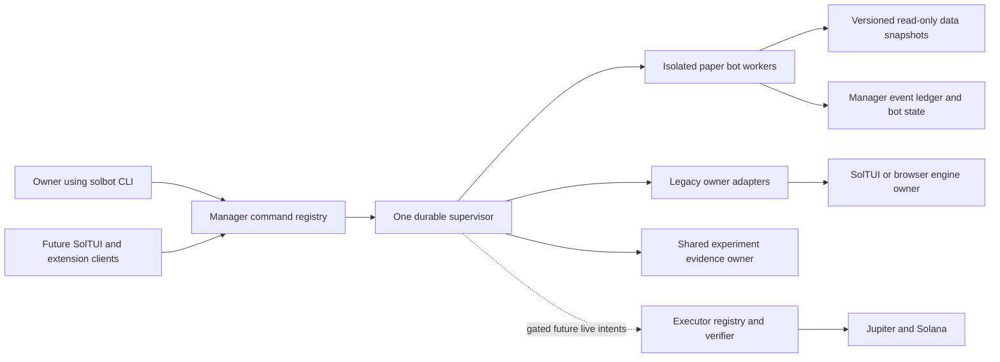

# Standalone Solana bot manager design

Version: 1.0.2
Delta: v1.0.1 to v1.0.2; record subsequent owner implementation approval and the immutable editing/adoption contract without relabelling historical design observations.
Delta: v1.0.0 to v1.0.1; make the first paper runtime independently buildable after builder review.
Status: approved architecture. Owner implementation approval is recorded in KNOW-1115 after planning PR171. Milestones1–2 shipped through PR175 and PR180; later capability remains subject to its own delivery and evidence gates.
Owner: repository owner. Tracking: TASK-1092.
Source baseline: 4d4c7a137b8f78a9e2655c059ca75dfcec0f2b36, inspected 2026-11-09.

## Subsequent implementation and editing authorization

The historical baseline observations below remain design evidence. They are not a current installed capability inventory. The owner subsequently approved implementation, requested editing and explicitly requested **all remaining milestones**. Follow the implementation plan and the current handoff for delivered capability. Earlier statements that this planning document alone authorizes no implementation do not revoke that later approval.

`edit` appends a saved configuration revision and preserves the stable bot UUID, prior values, provenance and manual pins. It cannot change the specification pinned to an active runtime. Status exposes saved and active revision/hash separately. `history` retains exact saved bodies and attributed run evidence. `schema` describes actual validated fields and available backend capabilities for the future Oracle visual interface.

`apply` is a separate, receipt-backed operation. The initial editing release accepts only a stopped, owner-released, reconciled reference run with zero exposure and compatible input. It archives the complete old run, fences the old generation and admits a new stopped runtime. It never starts trading, resets an existing run silently, deletes accepted request IDs, or replays an old control against a new runtime. Running or exposed bots may save edits, but cannot adopt them through this initial boundary. Expected revisions provide atomic compare-and-swap across editing and adoption. Later learning must add its own validated inventory-preserving boundary if required; a staged proposal cannot bypass this restriction.

Oracle and a later visual interface consume the manager's versioned registry, status and command receipts. The manager retains lifecycle, evidence and P&L authority. Reuse the existing Oracle producer/archive where suitable; do not create another recorder, optimizer, supervisor or signer in the UI. Source-labelled reference observations do not establish executable Jupiter fills or profitable parameters.

## Purpose and first useful outcome

Provide one CLI, proposed name `solbot`, for creating, evaluating, supervising and explaining persistent Solana/Jupiter bots. A bot is a durable identity with versioned configuration, runs and evidence. Closing the CLI must not stop it. Start and stop take an identity, without re-entering settings. Multiple bots may share a strategy while holding separate state and virtual capital.

First ship inventory, defaults and safe control of existing paper bots. Then ship the new multi-instance paper engine, data certification, blind selection, monitoring and learning. The runtime milestone first proves a grid vertical slice against existing read-only Coinbase recordings, labelled reference paper. Solana venue certification and the other adapters follow in the data milestone. Live trading is the last gated capability. This document authorizes no implementation or service changes. It assumes spot, long-or-flat, SOL/USDC initially; expands the mint universe only after a verified adapter and configured allowlist exist. No Base liquidity, perps, shorts, graphical redesign or profitability promise belongs in this first application.

## Current system and reuse decisions

Existing source paths below refer to the primary checkout at the stated baseline; proposed paths describe future modules. They describe code capabilities, not a fresh test run or installed-state verification.

| Source | Observed capability | Reuse and limit |
|---|---|---|
| `/Users/mitch/dev/solmargintrader/soltui/bots.py`: `BOTS`, `BOT_CHOICES`, `forward_start`, `forward_status` | Four workbench families: DCA, grid, triangle, trend; Council is a separate fifth choice. Forward records and in-memory replay sessions are keyed by family. | Discover through its owner. Do not call `forward_start` twice to create same-family variants: the second replaces the family slot. |
| `/Users/mitch/dev/solmargintrader/soltui/trend.py`: `TrendConfig`, `TrendFollowing` | Buffered SMA crossover with next-open fills. Current bot backtests use hours; forward replay uses minutes. | Extract/adapt pure logic with an explicit bar duration. A setting measured on hours is not a certified minute setting. |
| `/Users/mitch/dev/solmargintrader/backtester/core/strategies/signals.py`: `TsMomentum`; `/Users/mitch/dev/solmargintrader/backtester/core/strategies/__init__.py`: `REGISTRY` | Separate time-series momentum strategy, `ts_momentum`. | Use as requested momentum family; do not alias trend and momentum. |
| `/Users/mitch/dev/solmargintrader/backtester/core/gridsim.py`, `/Users/mitch/dev/solmargintrader/backtester/core/dcasim.py`, `/Users/mitch/dev/solmargintrader/backtester/core/trianglesim.py`; `/Users/mitch/dev/solmargintrader/extension/src/core/grid.js` | Offline ladder grid, safety-order DCA, triangle replay; browser grid economics. | Preserve tested economics. Grid exposure staircase in the strategy registry is a different mechanism. Backtester stays offline. |
| `/Users/mitch/dev/solmargintrader/soltui/experiments.py`: `ExperimentStore`; `/Users/mitch/dev/solmargintrader/soltui/experiment_runner.py` | Immutable specs/cells, chronological partitions, temporal exposure and holdout reservations, freeze/adopt flow and process locks. | Share this evidence owner and extend its protocol. A second experiment database with an independent holdout ledger would reopen spent evidence. Existing reports expose configs: not a blind judge boundary. |
| `/Users/mitch/dev/solmargintrader/soltui/forwardtest.py`: `defaults_path`, `save_default`, `load_session`; `/Users/mitch/dev/solmargintrader/soltui/bot_scheduler.py` | Durable trial/session evidence, scoped learned defaults, recurring optimizer. | Consume versioned snapshots. Do not launch another optimizer for the same work or overwrite manual settings. |
| `/Users/mitch/dev/solmargintrader/soltui/pricefeed.py` | Coinbase bid/ask/trade recorder, gzip JSONL, atomic latest snapshot, recorder lock, launchd keepalive. | Reuse unchanged as Coinbase research evidence. It is not a history of executable Jupiter routes. Keep its existing owner. |
| `/Users/mitch/dev/solmargintrader/soltui/commands.py`, `cli.py`, `api.py`, `native_host.py` | One command registry over several transports. | Adapter delegates lifecycle operations to that owner, with capability checks. Never import Textual UI to run a manager. |
| `/Users/mitch/dev/solmargintrader/extension/src/core/commands.js`, `bg/service-worker.js`, `storage/store.js`, `storage/fileStore.js` | Browser command owner uses IndexedDB and Chrome storage; Node uses a different FileStore. Native transport currently carries browser requests toward SolTUI. | A Node CLI does not discover browser-owned state. Add an explicit browser registration/command-poll bridge, not filesystem inspection of Chrome or a duplicate engine. |
| `/Users/mitch/dev/solmargintrader/executor/CLAUDE.md`, `/Users/mitch/dev/solmargintrader/executor/src/executor/registry.py`, `txverify.py`, `journal.py` | Guarded Jupiter Swap v1 spot operations, semantic verifier, journal/reconciliation, dry-run gates. No live strategy runner. | Future execution boundary; keep own environment and registry. Swap v1 verification does not certify Swap v2 or Trigger. |
| `/Users/mitch/dev/solmargintrader/mongo/README.md` | Rebuildable derived data. | Optional reporting projection, never bot/evidence authority or a new runtime prerequisite. |

Knowledge affecting the design: KNOW-871 requires train-only candidate choice and out-of-sample promotion; current experiment code adds sealed dates and exposure reservations. KNOW-891 scopes learning defaults by coin/trial/horizon. KNOW-885 requires reuse of the existing always-on recorder. KNOW-685 requires causal signals, explicit costs and an offline engine. Historical memory about forward-test restart gaps was treated as a lead and checked against current persistence; it is not evidence of a current installed defect.

## Approach and decisions

Three approaches were considered. A fresh independent service with copied strategies is easy to start but creates competing data, settings and research conclusions. Moving all existing interfaces into a new platform now makes this a UI rewrite with a large regression surface. The recommendation is a modular Python application with a durable local supervisor, pure strategy adapters and federated legacy owners. It starts independently of the UIs, then exposes one application command registry for their later integration.

These are proposed decisions, not owner-approved implementation choices. Use Python 3.13, stdlib-first CLI/SQLite/process control, and existing numeric dependencies for simulation. Keep one deployable application and one local supervisor. Avoid a broker, Redis, web frontend or microservices. An independently installed package declares every dependency; it must not rely on an accidental `PYTHONPATH` into this checkout. Initially pin an explicit compatible repository revision for adapters; later extract shared pure code into a small versioned package with contract tests. Do not copy and fork strategy implementations.



## Boundaries, identity and authority

Proposed package: `botmanager/`, module `botmanager`, executable `solbot`. Responsibilities:

- `domain.py`, `config.py`, `strategies/`: immutable BotSpec, effective defaults, pure strategy protocol.
- `registry.py`, `cli.py`, `transport.py`: one application command registry; CLI renders its response. Local supervisor uses a mode-0600 Unix socket and verifies peer/ownership where supported. No public listener in milestone 1.
- `store.py`, `ledger.py`: authoritative managed instance/config/state/event storage. SQLite on a local disk, bounded transactions, migrations and backup/restore; no network-mounted DB.
- `supervisor.py`, `worker.py`: durable desired state, lifetime locks, recovery, per-bot process isolation, bounded scheduling.
- `adapters/soltui.py`, `adapters/extension.py`, `adapters/executor.py`: process/transport contracts, explicit capability and schema versions, no direct legacy writes.
- `data.py`, `research.py`, `blind.py`, `learning.py`, `health.py`, `reports.py`: evidence manifests, existing research owner, isolated judge, training proposals, health and read models.

Bot ID is UUID, independent of strategy, code revision and display name. An external identity is `(source, installation_id, native_id)` with a unique mapping to a manager reference. `strategy_id`, `strategy_version`, `venue`, `base_mint`, `quote_mint`, bar duration, config revision/hash and execution model identify semantics. A run pins all these, plus dataset/cost hashes, clock range, random seed and reservation IDs. Config revisions append; history never changes under a running experiment.

Managed states: `created -> ready -> running -> paused/stopped`; `recovering`, `degraded`, `blocked`, `failed` are explicit states. Desired state and observed state are separate. A successful start request is not proof of a healthy running bot. Stop persists `desired=stopped` before stopping the worker; restart never resurrects a stopped bot. Stop and pause stop new work; they do not silently sell inventory. Position closing is a separate reduce-only command. Unknown outcomes survive all transitions.

`backtest`, `paper`, `live` are run modes, not mutable global defaults. Default is paper/disarmed; live requires an explicit pinned spec and existing execution gates. Read commands never ensure services, start workers, initialize owner databases, optimize or fetch data.

### Discovery and legacy management

`discover` reads configured installations through read-only owner adapters. Report source identity, strategy, active config hash, desired/observed state, heartbeat age, mode, capability set and reachability. Offline/unregistered browser is `unreachable` or `discovery_unavailable`, never an empty inventory certified as complete. Cached snapshots show their age.

SolTUI v1 controls use its registry, including `bots.overview`, `bots.config`, `bots.forward_start` and `bots.forward_stop` after runtime command discovery confirms names/parameters. Council uses its dedicated registry commands. For a family-scoped legacy session, label `one_instance_per_family`; serialize commands and reject conflicting creation. Do not infer multi-instance support from a strategy name.

Browser bridge proposal: extension registers a stable installation ID through its existing native host. Manager queues versioned requests; service worker polls through that same transport, dispatches only registry commands and returns durable request receipts/status. The manager cannot wake a closed browser; commands remain pending with a deadline. Add bridge actions only in `/Users/mitch/dev/solmargintrader/extension/src/core/commands.js`. No trading logic in bridge handlers; avoid exporting keys or wallet vaults. FileStore instances are separately registered Node installations, not browser aliases.

Legacy bots initially remain owner-controlled: CLI can discover, inspect and request advertised start/stop/config operations through the owner. Incompatible or unreachable owners have a specific capability error. Transfer to the new worker requires prepare/quiesce, owner receipt of stopped work, snapshot/checksum of lots/cursors/config, no unresolved intents, then commit new authority. Bind manager command request IDs and owner generation numbers; reconcile a lost acknowledgment rather than resubmitting. If a legacy owner lacks a durable handoff protocol, refuse transfer and continue delegated management. A lease stored only by the new manager cannot fence an unaware old owner.

## CLI and defaults

The following commands are proposed UX, not installed commands:

```text
solbot discover
solbot list
solbot create grid --name sol-grid
solbot start sol-grid
solbot create grid --name sol-grid-tight --set range_pct=10
solbot start sol-grid-tight
solbot status sol-grid --why
solbot config sol-grid --effective
solbot stop sol-grid
solbot data check sol-grid
solbot backtest sol-grid
solbot optimize sol-grid --blind
solbot report sol-grid --format json
solbot learn sol-grid
```

Name resolves uniquely or returns `ambiguous_identity`; IDs always work. All commands have help, schema version and request ID. Envelope: `{schema_version, request_id, ok, data, error}`; error carries `{code, message, retryable, detail_ref}`. Exit 0 success, 2 invalid input, 3 evidence/capability refusal, 4 operational failure. Start/stop use durable idempotency keys; repeated start returns the existing run. Unknown config keys, nonfinite numbers, wrong units and invalid parameter combinations fail before saving. Explicit false and zero are never treated as missing.

Resolution on creation: packaged strategy defaults < compatible shared learned defaults < saved named profile < creation overrides. Record each value's provenance. Resolver key includes strategy/code semantics, Solana venue, mints, timeframe and execution model. Coinbase learned parameters remain visible as research leads and cannot silently become Jupiter defaults. On restart use the pinned effective config, never re-resolve new defaults. A new config requires `config set` and a new config revision; running adoption occurs only at a safe boundary with a receipt. Manual pins win until explicitly returned to auto mode.

Every strategy adapter declares a complete typed schema, defaults, units, bounds, cross-field checks, warmup and supported modes. Initial strategy numbers come from existing constructors/cards, not undocumented replacements. Grid defaults: range 15%, 7 rungs, geometric spacing, deadband 25 bps, virtual capital $1,000. DCA defaults come from `DcaConfig` (base/safety $100, 5 safety orders, deviation/take-profit 2%, scales 1, stop loss 0%, cooldown 0, constructor venue minimum). Trend uses `TrendConfig` (10/30 bars, buffer 10 bps, virtual capital $1,000); momentum uses `TsMomentum` (60 bars, threshold 0). Arbitrage uses a versioned Solana schema; Coinbase `TriangleConfig` is only a reference, including its 35 bps edge, 1-second latency and $100 notional assumptions. Its taker fee is not a Jupiter fee.

Proposed application defaults: paper, disarmed, SOL/USDC, 1-minute closed bars, UTC, FIFO lots, one virtual $1,000 account per independent paper bot, 1 worker per bot, at most 4 active workers and 1 optimizer. These are operating defaults, not measured profitable settings. Queued bots remain visible. Portfolio paper mode instead shares one explicit capital account; do not sum independent virtual accounts as one funded wallet. Start/stop require no additional numbers. Historical interval mismatches force recomputation rather than scaling periods silently.

Proposed supervisor defaults: heartbeat every 5 seconds, stale at 15 seconds, one running tick per bot; restart delays 1/5/30 seconds and after 3 failures in 10 minutes hold `failed`. Poll reads use bounded timeout/backoff and a shared venue rate limiter with reserved capacity for control/reconciliation. Default quote age ceiling 5 seconds; high-frequency arbitrage may need a stricter approved profile. Live risk defaults come from executor policy, and existing configured caps cannot be raised: current code defaults include $25 position, $10 trade and $10 daily loss per strategy. A shared-wallet portfolio cap must be explicitly configured before live multi-bot mode; a new bot ID must never multiply exposure limits.

Credentials default to unavailable, not placeholder values. Price, quantity, fee, depth, decimals, token identity and wallet balances are observations, not configuration defaults. Missing observations block the affected simulation/execution and appear in diagnostics. Paper allocation is virtual; it never raises live limits.

## Five strategy families and executable semantics

Grid means paired ladder entries/exits one rung apart. DCA means the safety-order/deal engine here, not merely periodic dollar purchases. Trend means buffered SMA crossover; momentum means trailing-return exposure. Every adapter implements `initial_state(spec)`, `on_event(state,event)->(state,intents)`, and state serialization; backtest and forward adapters feed the same pure transitions. Existing batch replay can provide an incremental facade first, bounded by cursor/checkpoint and parity tests.

Jupiter swaps are market-like routed executions. A resting Trigger ladder and a bot that polls a price and submits swaps at thresholds have different fill economics. Keep `execution_model=trigger_ladder` or `swap_threshold`; certify each separately. Existing grid backtests support the ladder reference, not automatic certification of a swap implementation. Warmup emits no trade. Closed-bar signals act no earlier than the next eligible observation. Grid/DCA state survives config changes and restarts; never discard inventory to initialize a new ladder.

Arbitrage is Solana-only route/cycle research, not the existing Coinbase triangle relabelled. Three sequential Jupiter swaps are not an atomic arbitrage. Initial Solana arbitrage supports route recording, opportunity diagnosis and pessimistic paper replay. Require time-aligned executable quotes at requested sizes, route/depth/cost evidence, leg latency and unwind/failure models. If no proven atomic assembly/verifier exists, mark live unsupported. A profitable quoted cycle is not booked profit. This capability gap does not block paper testing other families.

## Data and honest backtesting

“Complete” means complete for a declared strategy, market, size, time range, granularity and execution model. A manifest records source/venue, mint/decimals, event and arrival time, bar closure, observation/slot IDs, sequence, gaps, duplicate/out-of-order counts, price/depth/volume availability, cost model, transformations and file hashes. Readers use immutable snapshots or stable high-watermarks, never hash a growing file and later assume it is unchanged. Preserve raw observations; derivatives name their lineage.

Read current Coinbase recordings/caches without a second recorder. Add a separate Jupiter collector only for missing venue-specific observations, under a single shared data-service owner used later by the UIs. Persist routes, requested atomic amounts, thresholds, route timestamp/slot, price impact, observed fees and supported expiry fields; rate-limit collection across bots. Point-in-time token membership avoids survivorship bias. Historical OHLC can support directional research but cannot reconstruct exact route fills, intrabar ordering, bid/ask or arbitrage execution. Missing history requires explicit forward collection or a labelled conservative proxy. Never backfill a quote with today's route.

Coverage checks produce `certified`, `proxy`, `incomplete`, `unsupported`. Proxy/exposed/stale-code results are inspectable but cannot pass a live promotion gate. New certified sessions do not flat-fill gaps by default; retain legacy bridged results with their original flag. Define required coverage before running; fail the run's certification if required fields or contiguous windows are missing. No fetching inside the backtest engine.

Model venue fees, slippage, size/impact, priority/base fees, failed attempts, rent separately from expense when recoverable, quote expiry, latency, unfilled and partial outcomes. Costs cannot disappear because a field is missing. In spot runs borrow is explicitly inapplicable; do not apply perp borrowing by accident. End-of-run inventory is marked and reported separately from captured trade profit. Baselines use the same capital/cost conventions (cash/no-trade and buy-and-hold).

Required tests: prefix invariance and a deliberate one-bar leak failure; next-event fills; hand-computed fee/lot round trips; future/stale quote refusal; missing/out-of-order/gapped data; insufficient liquidity/partial fills; batch-versus-stream parity for each adapter; checkpoint/restart equivalence; untradeable sizing; grid Python/JavaScript economic parity. Tests must fail when their guard is removed, rather than merely confirming a result object exists.

## Blind selection and repeated evaluation

Blinding removes parameter/incumbent bias; it does not prevent overfitting on reused outcomes. The existing experiment owner retains canonical candidates and the global exposure/holdout ledger. New selection protocol:

1. Freeze dataset hashes, strategy/timeframe/execution model, search budget, parameter ranges, objective version and chronological split BEFORE evaluation. Proposed initial split: oldest 50% training, next 25% validation, newest 25% sealed final. Purge/embargo by maximum feature/label/position-overlap horizon. If the strategy cannot fit warmup and enough observations in each segment, return insufficient evidence. Existing experiment partitions are retained for old runs, not relabelled.
2. Generator uses train evidence only, with a default budget of 32 configurations and 1,000 cells per run; stop on either limit. Include incumbent under an opaque ID. Validate train finalists on validation; freeze ONE challenger before final dates unseal. All inspected dates enter the shared exposure ledger, across old/new code and surfaces.
3. Resolver creates cryptographically random IDs and stores the mapping outside the judge's workspace. Judge runs in a separate process with an allowlisted input bundle; no repo/config access, paths, logs, strategy names, seed settings, incumbent flag, ordered parameter labels or parameter hashes. Metadata has an allowlisted schema; diagnostic text and trade labels cannot leak configurations. Blinding is an enforced input boundary, not a sentence in an LLM prompt.
4. Judge sees comparable net-return/drawdown/turnover distributions, sample counts, uncertainty, coverage flags and cost stress by anonymous candidate and chronological cell. Fixed deterministic judge is the default. Optional LLM commentary cannot select settings or override the score. Proposed scoring: reject invalid/uncertified or <30 completed trades; reject drawdown >20%; maximize median per-window net return minus 0.5 times per-window drawdown; tie-break lower turnover, then retain incumbent after resolver comparison. These are configurable policy defaults with explicit hashes; tune the strategy, not the judge on the final set. DCA/low-frequency bots may need a separately preregistered longer evaluation, never a lowered sample floor after observing results.
5. Resolver verifies judge signature/digest and permitted IDs, maps pick, and alone compares challenger/incumbent on paired fresh final windows. Preserve the existing positive-median and one-sided sign-test principle. Require at least 10 decided non-overlapping cells and account for cross-window dependence; group correlated assets/time blocks rather than call them independent trials. Proposed repeated-family decision control: alpha-spending `alpha_k=0.05/(k*(k+1))` for attempt k, shared across strategy/mint/timeframe/execution semantics. Report the sign test as descriptive if independence is unsupported; use a preregistered block-resampling confidence gate instead. Return insufficient evidence where blocks are too few.
6. Final outcomes are sealed as spent whether winner, loss or error after exposure. A new seed, bot ID or parameter-search hash cannot reopen them. Failed/dropped candidates remain in trial counts. New proposals need fresh dates or a preregistered sequential evaluation policy. Reveal mapping only after recording the signed verdict; preserve packets, mapping access log, rejection reasons and promotion receipt.

Blinding is across candidate parameters/incumbent identity, not a claim that performance trajectories reveal no strategy information. Test by permuting mapping/row order, inserting identifying metadata, attempting filesystem access, reading a frozen/spent date and fabricating a candidate ID. Invariance under relabelling is mandatory. No candidate can be selected from a missing or incomparable cell by treating missing performance as zero.

## Forward operation, monitoring and recovery

The supervisor persists desired state and generation before dispatch. Lifetime OS locks fence each instance; transactions serialize shared budgets, journal writes and idempotency records. Worker messages include generation; stale generations cannot write. A shared-wallet live executor is the sole order writer across all clients. If another surface cannot participate in the portfolio budget/ownership protocol, multi-owner live admission is refused.

Paper follows newly arriving data with recorded arrival times, same pure rules and execution model. An intent records the event/config/data evidence before simulated execution. No paper fill at an unavailable price. On sleep, disconnect or backlog, hold trading, mark delayed time ranges, and reestablish fresh state; do not pretend a backlog replay was real-time forward evidence. Checkpoint cursor and events atomically, detect corrupt tails, recover before resuming. Crash after an ambiguous live send always enters reconciliation, never resend.

Observe four distinct health dimensions: process heartbeat; data freshness/coverage; tick/ledger progress; performance against the pinned backtest/paper expectation. A process can be alive and not making progress. Proposed SLOs at 10 paper bots: CLI status p95 <1 second from local read models, crash/stall detection within 15 seconds, stop acknowledged within 2 seconds then termination by 10 seconds, no duplicate replay events/fills across forced crashes. Slow jobs cannot block stop/status. Bound per-bot queues; quarantine a failing bot without stopping others.

Performance warnings compare rolling costed return, drawdown, slippage/rejections and activity with baseline distributions and sample size. A net-loss trade alone is not a faulty call. Data/ledger uncertainty holds new exposure; risk breaches stop entries; reduce-only recovery retains verifier/allowlist checks. Record alert state with dedup/cooldown and resolution evidence. CLI events/status is mandatory; optional external notification transports require separate configuration.

## Learning, promotion and rollback

Every forecast has event time, decision horizon, predicted outcome and eventual label. Every trade has intended economics, actual fills/costs, market regime and rejection/execution diagnostics. Label incorrect forecast, unprofitable completed trade, execution miss and data fault separately. Open losing inventory is not silently labelled a closed loss. Train on all eligible resolved outcomes with loss cohorts for diagnosis; training only on losses changes the sampling distribution.

Learning proposes parameter changes or a new strategy version; it never patches active code or risk limits. Start with bounded local parameter search; no reinforcement-learning service or online weight mutation is required. Classify execution/data bugs for software repair rather than optimizing around corrupt evidence. A daily learning job by default creates at most one proposal per scope, after >=300 comparable resolved labels and >=30 completed trades, with a 48-hour promotion cooldown. These are conservative operating proposals, not validated profit thresholds.

Promotion requires certified compatible evidence, blind selection, untouched final acceptance, shadow paper comparison for at least 7 calendar days AND 30 completed trades, acceptable portfolio risk, unchanged manual pins and compare-and-swap config version. Otherwise keep incumbent. Preserve the existing forward-default evidence as prior research; its correctness-based posterior is not proof of net profitability. Automatic paper promotion is scoped to this bot/mint/timeframe/model; live promotion remains subject to executor gates and explicit live policy. Rollback can pin the prior config after reconciliation, preserving lots and pending intents; it does not undo trades or discard losses.

## Accounting and diagnostics

Append immutable events for lifecycle, observations, signals, intents, fills, rejects, fee components, marks, learning, verdicts and adoption. Carry bot/run/config/strategy IDs, event/arrival timestamps, source references and schema version. Redact secrets; persist wallets' public identities only where needed. Use integer token base units with verified decimals and decimal currency arithmetic. Unknown fee/mark/lot attribution is null plus a reason, never zero.

P&L reports realized, unrealized, gross, fee/carry/transaction expense, net, allocated capital, deposits/withdrawals and equity in USD and token units. With each expense booked once, `equity = cash + marked_inventory`; `net_pnl = equity - starting_equity - deposits + withdrawals`. Attribute FIFO cost including acquisition fees; sale fees count once. Pending spends and shared-wallet reservations remain separate from confirmed balances. Transfer/rent is not profit. Reconcile token/lamport deltas and transaction evidence; show unreconciled residuals.

`status --why` explains the last decision/no-trade, health, risk and data state. Reports include data coverage, baseline comparison, loss cohorts, confidence/sample size, rejected proposals, blind judge policy, training window/exposures, adopted versus manual values and exact reproducibility references. Default output is a compact operational table; details use subcommands/JSON/CSV. Logs are bounded/rotated; training/fill evidence retention cannot silently expire while still referenced. Backup ledger plus manifest snapshots and verify a restore before enabling unattended operation.

## Current Jupiter contract and live gate

Current official documentation retrieved via Context7 on 2026-11-09 describes Swap v2 `GET /swap/v2/order` and `POST /swap/v2/execute`, using `x-api-key`. The latter accepts signed transaction plus returned `requestId`; `/order` without taker is quote-only. V2's response details and transaction economics must be pinned with contract fixtures, not inferred from v1. Jupiter handling retries internally does not authorize this manager to retry an ambiguous submit. A request ID is not proven exactly-once semantics.

https://developers.jup.ag/docs/api-reference/swap/order

https://developers.jup.ag/docs/api-reference/swap/execute

https://developers.jup.ag/docs/swap/build

Repository policy still selects Swap v1 for the existing executor. The manager keeps that boundary; choosing v2 requires an explicit migration decision and independent economic verifier. Trigger live signing remains blocked, and SolTUI v2 manual previews are unsigned/refused for submit. Do not present any as a working autonomous live bot.

Postman API-engineer/discovery guidance was consulted. Orbit search returned a third-party read-only preview and unrelated APIs, not a suitable direct Jupiter contract; none was integrated. Postman CLI was unavailable, so Postman status/search/Context Graph were not used and no workspace was created. Official docs plus current repository contracts provide the planning evidence. No API calls that sign or submit were made.

## Acceptance, migration and remaining gates

| Requirement | Delivery gate |
|---|---|
| Long-lived bots / defaults | Two same-family instances restart with separate pinned config, lots and cursors; start/stop by ID is idempotent. |
| Complete useful backtesting | Manifests certify required coverage; causal/cost tests catch deliberate defects; incomplete Jupiter evidence cannot be promoted. |
| Blind selection | Isolated judge cannot access mapping; relabelling invariance; spent date and metadata leakage tests pass. |
| Real-time paper | Recorded event replay matches continuous operation; missing routes and stale reads never fill. |
| Maintenance | Forced crash/stall/disconnect/reboot/stop acceptance verifies identity and requested behavior, not PID alone. |
| Learning | Losing challenger rejected, compatible winner promoted only through gates; pins and rollback preserve positions. |
| Diagnostics / concurrent bots | Accounting identities reconcile, unknown values surfaced, 10-bot isolation and shared-budget tests pass. |
| Legacy integration | Actual browser and SolTUI identities discovered; owner command receipts and no-duplicate handoff verified. |

Migration is additive: new inventory references old artifacts; keep legacy owner as writer until a tested handoff; shadow the new engine; compare accounting and config semantics; then switch one bot. Roll back by stopping the new generation, reconciling pending work and restoring the prior owner with an explicit receipt. Never run both as writers. Later UIs become clients of the same manager registry instead of embedding another scheduler.

No owner decision blocks this planning deliverable. Proposed name, spot-only initial scope, defaults and policy thresholds are recorded assumptions open to correction before implementation. Live enablement depends on data certification, venue-specific verification, portfolio capital policy and installed acceptance. Solana arbitrage and Trigger have additional capability gates. These gaps are implementation milestones, not claims of current support.
