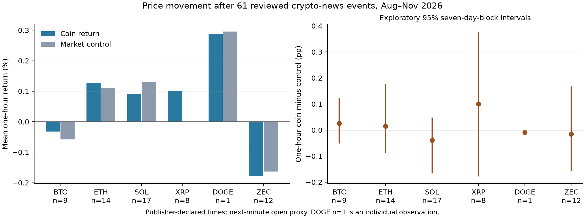

# Coin news publication and subsequent prices

Version: 1.0.0
Delta: initial measured, outcome-blind publication-time event study.

## What was measured

This exploratory study follows 61 reviewed coin/article events from August 14 through November 10, 2026 UTC (89 complete days). It measures subsequent Coinbase USD candle-open returns at 1, 5, 15, 60, 240 and 1,440 minutes. The primary horizon is one hour. It also measures a strictly prepublication 60-minute window and the same weekday/UTC time seven days earlier.

Five publishers supplied 6,603 source rows: CoinDesk, Cointelegraph, Decrypt, CryptoSlate and CryptoPotato. A fixed catalyst-keyword screen, exclusions for price commentary/promotions, earliest-event spacing of 24 hours per coin and a deterministic maximum-20-per-coin hash sample produced 103 candidates. Independent source/coin-role review retained 61 and rejected 42 before event outcome prices were fetched. Rejected candidates were not replaced. The reviewed sample is not a census of all major news or a random sample of all crypto articles.

DOGE has one retained event. Its row is an individual observation, not a coin-level estimate. The other counts are BTC 9, ETH 14, SOL 17, XRP 8 and ZEC 12. Some articles concern more than one coin; pooled rows are not independent stories. No bullish/bearish sentiment was inferred from event-type labels.

## Measured returns

Returns are percentages. Market-relative results are percentage points (pp). Counts show usable 1-minute / 1-hour / 24-hour observations; missing endpoints are never interpolated or replaced by the next observed row.

| Coin | N: 1m / 1h / 24h | Mean 1m return % | Mean 1h return % | Mean 1h market-relative pp | Mean 24h return % |
| --- | ---: | ---: | ---: | ---: | ---: |
| BTC | 9 / 9 / 9 | +0.001 | -0.032 | +0.026 | -0.294 |
| ETH | 14 / 14 / 14 | -0.020 | +0.125 | +0.015 | +0.879 |
| SOL | 17 / 17 / 17 | -0.020 | +0.090 | -0.039 | -0.072 |
| XRP | 8 / 8 / 8 | -0.054 | +0.100 | +0.100 | -1.663 |
| DOGE | 1 / 1 / 1 | -0.012 | +0.286 | -0.009 | +0.990 |
| ZEC | 12 / 12 / 12 | +0.009 | -0.179 | -0.016 | +1.658 |



The benchmark is the arithmetic mean of BTC and ETH simple percentage returns for SOL, XRP, DOGE and ZEC. BTC uses ETH as its benchmark; ETH uses BTC. Relative returns subtract the benchmark from the coin return. These are market controls, not beta-adjusted expected returns or causal counterfactuals.

## One-hour uncertainty and prior movement

Intervals below are exploratory, pointwise 95% percentile intervals from 1,999 resamples of epoch-anchored seven-day UTC publication blocks. They preserve same-block rows together. They are not simultaneous intervals across coins/horizons, and they do not establish an execution edge.

| Coin | Prepublication mean 60m return % | One-hour relative mean pp | Relative interval pp | Mean relative change versus prior-week window pp | Prior-week difference interval pp |
| --- | ---: | ---: | --- | ---: | --- |
| BTC | +0.076 | +0.026 | [-0.051, +0.124] | +0.153 | [+0.049, +0.280] |
| ETH | -0.314 | +0.015 | [-0.087, +0.179] | +0.020 | [-0.148, +0.189] |
| SOL | -0.079 | -0.039 | [-0.166, +0.048] | -0.161 | [-0.392, +0.055] |
| XRP | -0.005 | +0.100 | [-0.177, +0.378] | +0.097 | [-0.089, +0.285] |
| DOGE | +0.012 | -0.009 | unavailable | +0.555 | unavailable |
| ZEC | +0.266 | -0.016 | [-0.158, +0.168] | +0.619 | [+0.276, +0.940] |
| ALL | -0.031 | +0.006 | [-0.065, +0.084] | +0.118 | [+0.029, +0.209] |

Across the retained rows, the mean one-hour market-relative return is +0.006 pp, with interval [-0.065, +0.084]. The matched prior-week relative-return difference is +0.118 pp, with interval [+0.029, +0.209]. The prior-week windows may themselves contain news and differ in market regime; this comparison is descriptive.

## Timing and delayed-observation sensitivity

The entry proxy is the open of the first minute bucket strictly after the declared publication timestamp. The one-minute measurement ends at the next minute bucket's open. A Coinbase bucket open is its first trade, whose within-minute time is not supplied here. Thus this is a minute-bar proxy, not an exact 60-second return from the first public release, an executable quote or an assumed immediate fill. The prepublication window ends at the open of a fully earlier bucket, so it cannot include the postpublication entry price.

Of the 61 retained rows, 18 publication times come directly from publisher APIs and 43 are archive-declared publisher times. For those 43, archive first_seen lagged the declared publication time by a median 40.31 minutes (range 6.92–74.88). That archiver did not deliver those items at their declared release time. Its first_seen is not the first time any market participant saw the story. Three direct-publisher records show revisions after publication; current wording is not proof of the original headline. No historical sentiment claim is made.

The predeclared five-minute delay check moves the entry and exit five minutes later while preserving the horizon. The comparison below uses the same available rows in both timing cases for each metric; it does not compare a full sample with a missing-endpoint subset. It is a sensitivity check, not a measured feed latency or a timing optimization.

| Coin | Paired N: 1m / 1h | Immediate-proxy 1m mean % | Delayed-proxy 1m mean % | Immediate-proxy 1h relative pp | Delayed-proxy 1h relative pp |
| --- | ---: | ---: | ---: | ---: | ---: |
| BTC | 9 / 9 | +0.001 | -0.003 | +0.026 | +0.014 |
| ETH | 14 / 14 | -0.020 | +0.049 | +0.015 | +0.060 |
| SOL | 17 / 17 | -0.020 | -0.014 | -0.039 | -0.041 |
| XRP | 8 / 8 | -0.054 | -0.001 | +0.100 | +0.135 |
| DOGE | 1 / 0 | -0.012 | -0.012 | unavailable | unavailable |
| ZEC | 12 / 12 | +0.009 | +0.022 | -0.016 | -0.179 |
| ALL | 61 / 60 | -0.016 | +0.011 | +0.006 | -0.014 |

## Concrete article examples

These examples illustrate different reported contexts. They are not selected trading rules, causal attribution or independent replications.

SafePal Bitcoin Wallet Data Breach Stokes Fears of Physical Attacks — declared publication 2026-08-17T09:31:04.000Z; BTC return +0.214% at one hour and +1.282% at 24 hours. One-hour market-relative return: -0.127 pp.
https://decrypt.co/375743/safepal-bitcoin-wallet-data-breach

No, Ledger Wasn’t Hacked: Vulnerable Ethereum App Was Patched Before Exploit, Company Says — declared publication 2026-08-27T18:16:03.000Z; ETH return +0.557% at one hour and -2.314% at 24 hours. One-hour market-relative return: +0.350 pp.
https://decrypt.co/376750/no-ledger-wasnt-hacked-ethereum-app-exploit

Solana doubles block production speed to 200ms as network prepares for Alpenglow upgrade — declared publication 2026-10-10T00:40:59Z; SOL return +0.339% at one hour and +0.568% at 24 hours. One-hour market-relative return: +0.210 pp.
https://cryptoslate.com/solana-doubles-block-production-speed-to-200ms-as-network-prepares-for-alpenglow-upgrade

XRP Ledger set to fix flaw that could let stablecoin partners print new tokens — declared publication 2026-11-02T12:37:24.000Z; XRP return +0.352% at one hour and +2.552% at 24 hours. One-hour market-relative return: +0.095 pp.
https://www.coindesk.com/tech/2026/11/02/xrp-ledger-set-to-fix-flaw-that-could-let-stablecoin-partners-print-new-tokens

Zcash activates NU7 on testnet ahead of November mainnet target — declared publication 2026-10-05T03:47:19.000Z; ZEC return -0.783% at one hour and +0.529% at 24 hours. One-hour market-relative return: -0.094 pp.
https://cointelegraph.com/news/zcash-nu7-testnet-activation-november-mainnet

Zcash gets first European ETP following US ETF launch — declared publication 2026-09-22T16:21:44.000Z; ZEC return +1.201% at one hour and +1.123% at 24 hours. One-hour market-relative return: +0.767 pp.
https://cointelegraph.com/news/21shares-zcash-etp-europe-etherfi

## Interpretation limits

The results describe what happened after this selected set of reported articles. They do not show that publication caused the move. A filing, announcement, social post, leak or another publisher may have released the information first. Publication often follows an underlying event. Absolute movement and directional accuracy answer different questions. Positive average returns do not establish a rule that can choose direction in advance, and this timing study does not calibrate a 70% next-minute forecast.

Selection was fixed before fetching outcome prices, but the publisher/keyword/availability sample remains selective. The reviewed event classes mix distinct economic mechanisms. No trading rule or sentiment model was fitted, and no fee-free profitability claim follows. Reserved unsealed price windows were excluded for the coin and its BTC/ETH controls, including the prior-week queries. Existing capture, paper/live owners, orders and paused inference/embedding services were left unchanged.

## Reproduce and inspect

```sh
INDEX_NO_AUTO=1 /Users/mitch/.venvs/soltui/bin/python -m research.news_event_study --home /Users/mitch/.local/share/solmargintrader/research/news-events-20261112 --output /Users/mitch/.local/share/solmargintrader/research/news-events-20261112/reproduction-new
```

Use a fresh output directory. The CLI verifies that the frozen event identities and timestamps match the checksum-bound independent inclusion ledger before computing results. Private raw sources and price responses remain outside Git. The compact event-return CSV contains each article URL, declared publication time, timestamp source, entry proxy, usable outcomes and controls. The eligibility CSV explains each initial candidate's inclusion or rejection.

The manifest distinguishes the source frozen before price retrieval from the executed analysis source. The later source adds cohort/checksum enforcement and quieter CLI output. The statistical and selection function ASTs are unchanged. Both source snapshots, their exact checksums and the complete delta are retained in the private evidence inventory; the historical freeze manifest was not rewritten.

- Compact event returns: [news_events_20261112_event_returns.csv](results/news_events_20261112_event_returns.csv)
- Summary and uncertainty: [news_events_20261112_summary.csv](results/news_events_20261112_summary.csv)
- Eligibility audit: [news_events_20261112_eligibility.csv](results/news_events_20261112_eligibility.csv)
- Bound manifest: [news_events_20261112_manifest.json](results/news_events_20261112_manifest.json)

Primary interface documentation:
https://docs.cdp.coinbase.com/api-reference/exchange-api/rest-api/products/get-product-candles
https://cryptocurrency.cv/api/archive
https://github.com/nirholas/cryptocurrency.cv/blob/main/docs/reference/archive.md
https://cryptoslate.com/wp-json/wp/v2/posts
https://cryptopotato.com/wp-json/wp/v2/posts

Shared canonical llms and graph retrieval are delivered separately from these reproducible source artifacts. The final delivery receipt identifies their exact shared path and verification. This report does not reopen the prior full-suite or claim a new saturation result.
