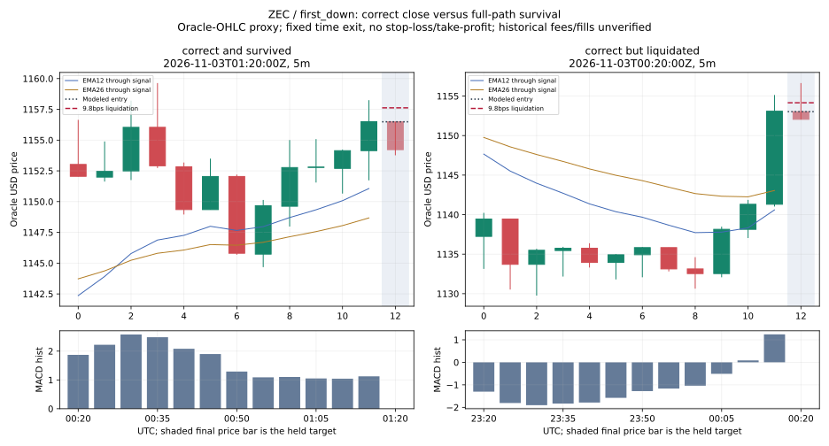
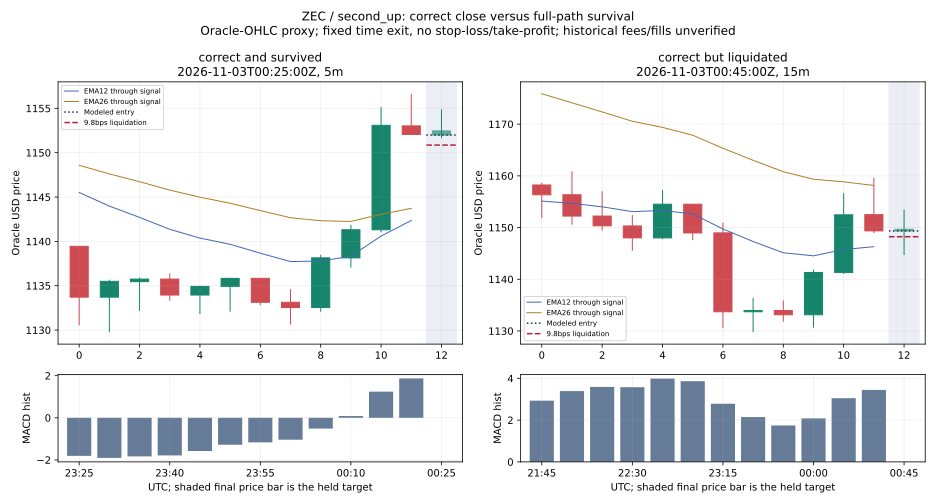
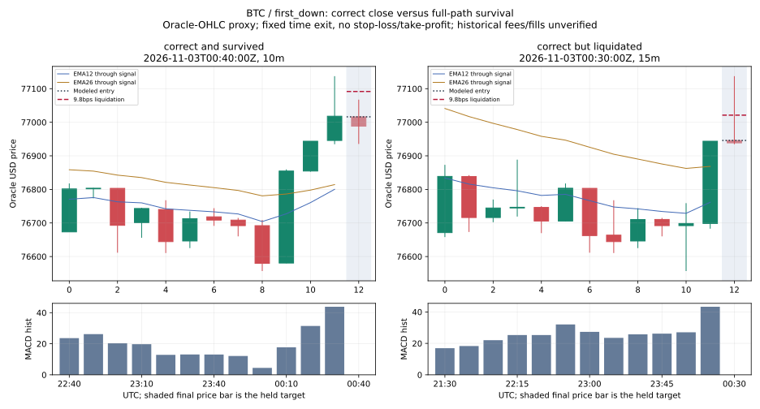
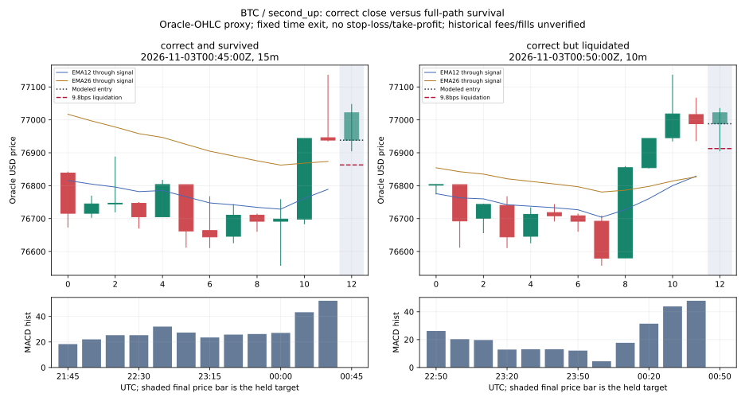

# First reversal, second reversal and 1000x liquidation path

A correct closing direction does not establish a surviving 1000x trade. The tables below require the entire holding bar to stay inside the modeled liquidation boundary. No stop-loss or take-profit is assumed; exit is at the target bar's close.

The first decision is SHORT after two completed UP bars. The second is LONG only after UP–UP–DOWN has completed. Each uses information available at its own entry. A DOWN bar's wick or indicator value is unavailable when forecasting that same DOWN bar.

## Price path and liquidation

The main results use Jupiter's historical fixed_rate@200ms oracle OHLC for both signals and outcomes. Each asset has 41,680 complete minutes in 14 exact pages. Independent first-minute BTC and ZEC sample checks reproduced those oracle highs/lows from 300 consecutive 200 ms observations. These probes do not certify every historical update consumed by the keeper.

The official client reserves the close fee: F=min(M,floor(N×20/1000000)). A long is liquidatable when N×(entry−price)≥(M−F)×entry; the short uses price−entry. At 1000x and the current 20 ppm close fee, the modeled adverse boundary is 9.8 bps (0.098%). Touching it counts. Historical fee settings, actual fills, latency and keeper/on-chain equivalence remain unverified. Sensitivities at 5/7.5/10 bps are retained in the full results.

The client also has a nonlinear favorable-payout curve, a 0.2 bps favorable dead zone and profit fees. This study does not multiply spot returns by 1000 or claim executable P&L.

## Unfiltered final-split results

Joint means the direction was correct AND the 9.8 bps barrier was never touched during that complete target bar. All setups, including failures and flats, stay in the denominator.

| Asset | Entry setup | Minutes | Direction correct | Correct and survived | Correct but liquidated |
|---|---|---:|---:|---:|---:|
| ZEC | UU → SHORT | 5 | 202/427 (47.3%) | 121/427 (28.3%) | 81 |
| ZEC | UU → SHORT | 10 | 110/212 (51.9%) | 50/212 (23.6%) | 60 |
| ZEC | UU → SHORT | 15 | 66/139 (47.5%) | 25/139 (18.0%) | 41 |
| ZEC | UU → SHORT | 20 | 52/106 (49.1%) | 21/106 (19.8%) | 31 |
| ZEC | UUD → LONG | 5 | 101/202 (50.0%) | 69/202 (34.2%) | 32 |
| ZEC | UUD → LONG | 10 | 54/110 (49.1%) | 31/110 (28.2%) | 23 |
| ZEC | UUD → LONG | 15 | 35/66 (53.0%) | 13/66 (19.7%) | 22 |
| ZEC | UUD → LONG | 20 | 22/52 (42.3%) | 9/52 (17.3%) | 13 |
| BTC | UU → SHORT | 5 | 216/402 (53.7%) | 206/402 (51.2%) | 10 |
| BTC | UU → SHORT | 10 | 114/207 (55.1%) | 101/207 (48.8%) | 13 |
| BTC | UU → SHORT | 15 | 68/125 (54.4%) | 56/125 (44.8%) | 12 |
| BTC | UU → SHORT | 20 | 51/97 (52.6%) | 40/97 (41.2%) | 11 |
| BTC | UUD → LONG | 5 | 110/215 (51.2%) | 105/215 (48.8%) | 5 |
| BTC | UUD → LONG | 10 | 55/113 (48.7%) | 50/113 (44.2%) | 5 |
| BTC | UUD → LONG | 15 | 28/68 (41.2%) | 24/68 (35.3%) | 4 |
| BTC | UUD → LONG | 20 | 22/50 (44.0%) | 18/50 (36.0%) | 4 |

Longer bars expose a position to more adverse movement before the fixed exit. A later favorable close cannot recover a position already liquidated. These conditional rates are not a prospective accuracy or profit guarantee.

## What the frozen validation selector chose

Each asset has 408 predeclared interval/condition/basis candidates. Eligibility is training ≥40 and validation ≥20. Ranking uses the validation Wilson lower bound for JOINT success, then sample count and stable ID. Final-split results never rerank these choices. All of these histories were already studied, so the entire extension remains exploratory and retrospective.

| Asset | Oracle signal gate | Validation direction | Validation joint | Final direction | Final joint |
|---|---|---:|---:|---:|---:|
| ZEC | first_down 5m / macd_improving | 181/335 (54.0%) | 128/335 (38.2%) | 181/385 (47.0%) | 104/385 (27.0%) |
| ZEC | second_up 5m / macd_weakening | 58/106 (54.7%) | 42/106 (39.6%) | 52/110 (47.3%) | 35/110 (31.8%) |
| BTC | first_down 5m / macd_improving | 184/346 (53.2%) | 180/346 (52.0%) | 188/363 (51.8%) | 179/363 (49.3%) |
| BTC | second_up 20m / ema_up | 23/31 (74.2%) | 22/31 (71.0%) | 13/29 (44.8%) | 11/29 (37.9%) |

## Correlates worth observing prospectively

The following is a POST-HOC descriptive screen, not a new validated strategy selection. It requires positive directional lift over the same-interval baseline in train, validation and final splits, with training ≥40 and both later splits≥20. Rows are ordered by the minimum lift across those splits; only two per asset/stage are printed. This screen uses final outcomes, has many comparisons, and cannot qualify a forward winner.

| Asset | Stage | Minutes / gate | Train direction | Validation direction | Final direction | Final lift pp | Final joint |
|---|---|---|---:|---:|---:|---:|---:|
| ZEC | first_down | 15 / close_high | 95/178 (53.4%) | 34/52 (65.4%) | 31/59 (52.5%) | +5.06 | 6/59 (10.2%) |
| ZEC | first_down | 5 / close_high | 330/601 (54.9%) | 118/206 (57.3%) | 126/234 (53.8%) | +6.54 | 70/234 (29.9%) |
| ZEC | second_up | 10 / shape_rising | 36/71 (50.7%) | 11/22 (50.0%) | 15/28 (53.6%) | +4.48 | 9/28 (32.1%) |
| ZEC | second_up | 10 / close_low | 78/159 (49.1%) | 29/67 (43.3%) | 35/69 (50.7%) | +1.63 | 19/69 (27.5%) |
| BTC | first_down | 15 / rsi_high | 79/142 (55.6%) | 26/39 (66.7%) | 26/47 (55.3%) | +0.92 | 21/47 (44.7%) |
| BTC | first_down | 10 / macd_improving | 264/510 (51.8%) | 87/162 (53.7%) | 100/180 (55.6%) | +0.48 | 87/180 (48.3%) |
| BTC | second_up | 10 / upper_wick | 39/75 (52.0%) | 19/35 (54.3%) | 17/30 (56.7%) | +7.99 | 16/30 (53.3%) |
| BTC | second_up | 20 / shape_range | 52/94 (55.3%) | 28/37 (75.7%) | 14/30 (46.7%) | +2.67 | 13/30 (43.3%) |

Gate definitions: close_high/close_low mean the completed signal bar closes in its top/bottom quarter. Wick gates require at least 35% of that bar's range. RSI high is ≥60. Rising/falling/range use 48 completed bars. EMA direction compares EMA 12/26; MACD improving/weakening compares its 12/26/9 histogram with the previous completed bar. A shallow pullback's DOWN body is ≤half the two preceding UP bodies combined.

For the first reversal, test rejection/extension and regime together; a strong UP close can correlate with a later DOWN bar without making its adverse wick safe. For the second reversal, a rising regime, pullback depth, wick geometry and momentum change are separate causal hypotheses. The familiar uptrend-plus-shallow-pullback story is not assumed successful: its complete cells remain in the archive even when it fails. Full point-biserial feature correlations and successful/failed feature means are retained for every split.

Oracle volume semantics are unqualified and volume features are unavailable in the primary study. The diagnostic spot_signal basis uses Binance pattern/indicator/volume inputs but still executes and scores against the matched oracle target bar; it has its own complete counts and frozen selections. No spot/oracle entry prices are mixed.

## Detailed instances and charts

Examples below are the first three correct survivors and first three correct-but-liquidated events per asset/stage in the final split, sorted by entry time then interval. They were not selected for largest profits. The four charts show the first example of each class and use indicators only through entry.

| Asset | Stage | UTC entry | Minutes | Class | Oracle entry | Oracle high | Oracle low | Oracle close | Adverse bps |
|---|---|---|---:|---|---:|---:|---:|---:|---:|
| ZEC | first_down | 2026-11-03T01:20:00Z | 5 | correct_and_survived | 1156.48767615 | 1156.48767615 | 1153.76653092 | 1154.22055271 | 0.000 |
| ZEC | first_down | 2026-11-03T01:30:00Z | 10 | correct_and_survived | 1156.49206553 | 1156.56694543 | 1147.57954799 | 1149.63173512 | 0.647 |
| ZEC | first_down | 2026-11-03T01:30:00Z | 15 | correct_and_survived | 1156.49206553 | 1156.56694543 | 1144.30861231 | 1146.00318578 | 0.647 |
| ZEC | first_down | 2026-11-03T00:20:00Z | 5 | correct_but_liquidated | 1153.02279564 | 1156.64433098 | 1152.02943757 | 1152.05561983 | 31.409 |
| ZEC | first_down | 2026-11-03T00:20:00Z | 10 | correct_but_liquidated | 1153.02279564 | 1156.64433098 | 1151.62538564 | 1152.46028555 | 31.409 |
| ZEC | first_down | 2026-11-03T00:30:00Z | 15 | correct_but_liquidated | 1152.49142261 | 1159.63547910 | 1148.95176379 | 1149.35111425 | 61.988 |
| ZEC | second_up | 2026-11-03T00:25:00Z | 5 | correct_and_survived | 1151.99017283 | 1154.88719092 | 1151.62538564 | 1152.46028555 | 3.167 |
| ZEC | second_up | 2026-11-03T00:30:00Z | 10 | correct_and_survived | 1152.49142261 | 1159.63547910 | 1151.75445598 | 1152.91145480 | 6.395 |
| ZEC | second_up | 2026-11-03T03:15:00Z | 5 | correct_and_survived | 1135.67570430 | 1139.63361511 | 1135.67570430 | 1138.82638017 | 0.000 |
| ZEC | second_up | 2026-11-03T00:45:00Z | 15 | correct_but_liquidated | 1149.34996490 | 1153.49107055 | 1144.67392475 | 1149.66389079 | 40.684 |
| ZEC | second_up | 2026-11-03T01:25:00Z | 5 | correct_but_liquidated | 1154.23052733 | 1156.71671517 | 1152.28039364 | 1156.50206017 | 16.896 |
| ZEC | second_up | 2026-11-03T03:30:00Z | 5 | correct_but_liquidated | 1131.74833117 | 1133.27591120 | 1129.29223530 | 1132.93863647 | 21.702 |
| BTC | first_down | 2026-11-03T00:40:00Z | 10 | correct_and_survived | 77016.19643762 | 77067.40024125 | 76935.29789944 | 76988.23737905 | 6.648 |
| BTC | first_down | 2026-11-03T01:10:00Z | 5 | correct_and_survived | 77111.13691721 | 77146.75468795 | 77061.34533370 | 77105.18493630 | 4.619 |
| BTC | first_down | 2026-11-03T01:20:00Z | 20 | correct_and_survived | 77173.65390541 | 77199.20042624 | 77018.19261098 | 77052.59474699 | 3.310 |
| BTC | first_down | 2026-11-03T00:30:00Z | 15 | correct_but_liquidated | 76945.76393930 | 77137.31832100 | 76934.49034557 | 76938.54271897 | 24.895 |
| BTC | first_down | 2026-11-03T00:35:00Z | 5 | correct_but_liquidated | 77022.01178728 | 77137.31832100 | 77016.07247156 | 77018.08970992 | 14.971 |
| BTC | first_down | 2026-11-03T07:30:00Z | 5 | correct_but_liquidated | 76769.00000000 | 76852.34000000 | 76744.39747175 | 76744.78183175 | 10.856 |
| BTC | second_up | 2026-11-03T00:45:00Z | 15 | correct_and_survived | 76938.35273088 | 77048.19842235 | 76904.60533889 | 77021.60000000 | 4.386 |
| BTC | second_up | 2026-11-03T01:15:00Z | 5 | correct_and_survived | 77105.18493630 | 77192.02560084 | 77037.41622031 | 77175.10018708 | 8.789 |
| BTC | second_up | 2026-11-03T01:40:00Z | 10 | correct_and_survived | 77052.90295706 | 77103.27670976 | 76983.86220473 | 77103.27670976 | 8.960 |
| BTC | second_up | 2026-11-03T00:50:00Z | 10 | correct_but_liquidated | 76988.23737905 | 77036.01685920 | 76904.60533889 | 77021.60000000 | 10.863 |
| BTC | second_up | 2026-11-03T16:20:00Z | 20 | correct_but_liquidated | 77451.25475830 | 77531.33784640 | 77272.51256605 | 77485.50585825 | 23.078 |
| BTC | second_up | 2026-11-04T01:10:00Z | 10 | correct_but_liquidated | 76865.88086615 | 76932.93037842 | 76710.56901967 | 76868.24867456 | 20.206 |

## Evidence and forward use

Full native inputs, all 24,480 events, all 816 candidate rows, all split metrics, source pages, causal features and numerical audit bindings are listed in second-turn-20261116/manifest.json. Each rate is descriptive: overlapping setups, serial dependence and multiple comparisons are not corrected by the Wilson intervals.

The existing live paper selection stays frozen. These new oracle/second-turn hypotheses need a separately frozen prospective test before becoming a claimed improvement. A future entry's actual oracle fill, exact liquidation threshold and observed adverse path must be recorded; no heuristic can promise that its price will never cross liquidation.

