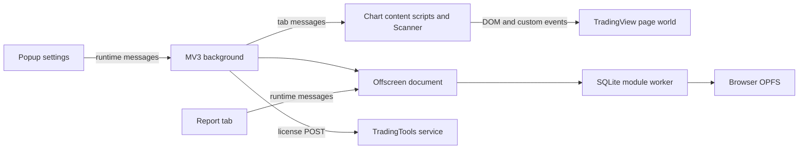

# Architecture

## Context

The user runs a Chrome extension over a TradingView chart. Content scripts manipulate chart inputs and collect strategy/indicator results. The background worker routes messages across extension contexts. An offscreen page hosts the database worker, and a report tab displays stored results. Registration uses a separate TradingTools service.

The diagram is a static control/data map inferred from manifest declarations, worker construction and visible message names. Obfuscation limits verification of exact branches and failure handling.

## Context boundaries

- `manifest.json` lists content scripts in order and injects into all matching frames. Start/end injectors bridge to page scripts; they are distinct from the isolated content-script world.
- `background.js` is an ES module importing UUID and Luxon. It creates `off_screen.html` and routes scan/database/license messages.
- `off_screen.html` loads `off_screen.js`, which constructs `sqlite_worker.js` as a module Worker.
- `sqlite_worker.js` contains SQLite initialization, SQL table/column operations, OPFS access and import/export message handlers.
- `report.html` loads report logic plus jQuery, Tabulator, Highcharts and three.js assets.

## Recorded decisions

2026-11-08: preserve the supplied source and browser wiring. The documentation-only bootstrap introduces no runtime framework, operations registry, watcher, build pipeline or authentication changes. The parent continues to ignore the upstream source; only new docs are tracked. Derived retrieval data stays in the local hub.

Sources: `manifest.json`; `background.js`; `off_screen.js`; `sqlite_worker.js`; `report.html`; `js/injectors/`; `js/classes/scanner.js`.
