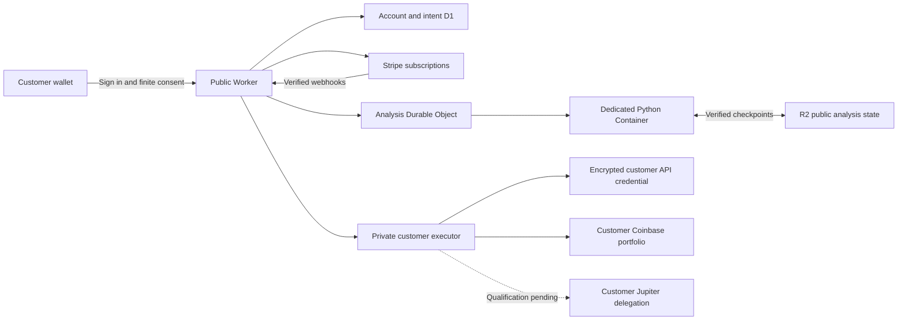

# oraclebot.io

Version: 0.4.0

Oraclebot separates the public account service, analysis runtime and customer
execution service. The local owner control room remains independent. This source
release adds hosted infrastructure and financial controls; production launch
still requires the provider acceptance gates below.



## Accounts and subscriptions

Solana wallet sign-in uses a domain-bound, expiring, single-use message. D1
stores account records and hashes of session credentials. Signing in grants
account access. Trading requires its own finite wallet-signed authorization.

| Plan | Monthly base rate, USD before applicable tax | Configured bot slots | Backtests per UTC day |
| --- | ---: | ---: | ---: |
| Starter | 9.99 | 3 | 10 |
| Advanced | 29.99 | 10 | Unlimited |
| Unlimited | 49.99 | Unlimited | Unlimited |

The first eligible subscription receives seven days free. Server-selected
Stripe Prices determine payment and entitlement. Canonical signed webhook
reconciliation grants access; a Checkout redirect cannot grant access. Trial
history survives account deletion as a wallet hash.

Plan changes require a server-priced preview and an explicit commit. Upgrades
use pending payment confirmation; downgrades take effect at renewal. Trial
changes preserve the original trial end. Undoing an owned downgrade releases its
subscription schedule. Cancellation and undo-cancellation never resurrect a
terminated subscription. Durable operations retain unknown outcomes for
reconciliation, including when the browser loses the response. The dedicated
portal supports payment methods, invoices and cancellation; portal plan changes
must remain disabled while the application owns those lifecycle semantics.

Plan quotes distinguish the monthly base price from the gross amount due now.
Automatic tax and Stripe Managed Payments settings remain bound to the quote
and survive scheduled changes. A changed tax calculation requires a new quote.
Cancellation supports Stripe's period-end flag and explicit cancellation date;
undo verifies that both representations have cleared before reporting success.

Configured definitions reserve slots. Pausing and archiving free slots. Creation
and activation enforce slot capacity atomically. After a downgrade below current
usage, managed bots hold new buys until the customer frees enough slots. A
verified reduce-only sale can still reduce owned exposure under a current grant.
Unlimited counts retain per-request resource, financial and concurrency limits.

## Dedicated analysis

`runtime/wrangler.jsonc` defines one fixed Durable Object owning a Cloudflare
Container. `engine/Dockerfile` installs the canonical backtester and Oracle
packages in a nonroot Linux image. The service acquires public Coinbase USD
candles and genuine market observations for SOL, BTC, ETH and ZEC. It accepts
named analysis operations with a private service credential. It has no customer
signer, account credential or owner cache fallback.

Each coin has its own native Oracle history. Closed historical candles can warm
strategy features; they cannot create retrospective forecasts or outcomes.
Leaders require eligible, fresh evidence. The public Oracle may abstain while
history warms, observations are stale, or no strategy qualifies. The site does
not manufacture a direction to fill that state. Genuine future observations
resolve prospective forecasts and forward paper outcomes.

R2 content-addressed chunks and an epoch-fenced Durable Object head commit the
runtime's public history, frozen calculation inputs and job database. The image
restores and verifies the committed snapshot before accepting work. Unavailable
or corrupt storage withholds readiness. Ephemeral container disk is insufficient
for durability. Current state has an eight-GiB bound; long-term R2 retention and
capacity still require operations monitoring.

`POST /api/backtest-jobs` creates an owned durable calculation with an idempotency
key. A lost HTTP reply preserves its job ID and credit reservation. The same key
recovers the same request; another request cannot replace it. A verified complete
receipt consumes one daily credit. A durable failed receipt releases it. Polling
and the minute cron reconcile pending work. Legacy synchronous backtests remain
available with their existing timeout semantics. Status and results are bound to
the owner and the exact request hash.

The runtime's authenticated `/v1/signals` endpoint computes the canonical spot
strategy on fully closed contiguous bars with fill delay one. It returns exact
strategy/source/input revisions, observation times and a short expiry. Fractions,
lookahead, stale data and unusable inputs cannot trigger the initial managed
0-or-1 exposure driver. A strategy signal does not serve as an execution quote.

## Customer execution and managed bots

`execution/wrangler.jsonc` defines a private Worker and one serialized Durable
Object per customer. The public edge passes only the authenticated principal.
It cannot select an operator wallet or an arbitrary signer endpoint.

Customers can import a dedicated Coinbase ECDSA API credential with View and Trade
permissions. Transfer-enabled credentials are refused. AES-GCM encryption and
owner/wallet/connection binding protect the credential in private storage. The
public registry stores metadata and fingerprints. Revocation removes unused
authority; unresolved orders retain reconciliation capability. Rotation retains
idempotency and public audit history without retaining every old encrypted key.

The executor reconciles the venue before preparing an order. It verifies fresh
prices, decimal increments, fees, explicit previews, signed policy, subscription,
connection ownership, expiry and cumulative reservations again before signing.
It submits an explicit limit IOC using a stable client order ID. An ambiguous
submit remains unknown and is never automatically sent again. Only authoritative
venue fills update bot-owned inventory. Partial fills remain visible.

Paper definitions remain the default. Activation requires a separate Ed25519
wallet signature over the exact bot, immutable strategy revision, customer
connection, closed-bar interval, per-trade/cumulative notional limits and expiry.
External MCP grants cannot activate a managed bot. The minute scheduler dedupes
signals, durably records preparations before submission and reconciles pending
orders before taking another action. Pausing revokes its managed grant. It does
not close the position. Expiry, revocation and exhausted authority can prevent an
automated exit; the consent message states these limits.

A managed sale is reduce-only and capped by that bot's verified fill ledger. The
private signer also verifies fresh aggregate inventory covering all bots in the
same portfolio/asset, including paused allocations, and refuses while another
bot's unapplied order makes coverage uncertain. Manual depletion cannot silently
move another bot's backing into a managed sell.

Account deletion first installs a durable financial-write fence, calls the
private executor even if the registry is empty, and verifies encrypted credential
erasure. A lost cleanup response retains the same fence for safe retry. Pending
trades, Checkouts and unresolved subscription changes prevent deletion.

## Authenticated MCP

Connect an OAuth-capable client to https://oraclebot.io/mcp . The service exposes
MCP2025-11-25 stateless Streamable HTTP with public-client PKCE S256, exact resource
and redirect binding, short-lived hashed access tokens, rotating refresh tokens
and immediate revocation. Cookies cannot replace bearer authority.

Tools: `oraclebot_get_status`, `oraclebot_request_trade`,
`oraclebot_get_trade_status`, and `oraclebot_submit_trade`. The principal always
comes from the authenticated grant. Tool arguments cannot override wallet,
customer, signer or endpoint. Preparation and submission use the initial finite
preauthorization without a wallet prompt for every trade.

Legacy five-field trading policies authorize spot at 1x. Version2 explicitly adds
products and maximum leverage. USD limits count fee-inclusive notional exposure,
including leveraged position notional. Broadening a policy requires fresh consent.

## Jupiter qualification

Jupiter native perpetual delegation remains disabled. Qualification uses the
actual deployed Smart Account and Perps binaries in an isolated signature-checked
SVM with public protocol accounts. Constrained SOL-short and ETH-long request
creation, negative policy controls, and owner recovery of an expired unfilled
request have passed. These results do not establish keeper settlement, closure of
a filled leveraged position, a non-bypassable cumulative funding bound or complete
customer onboarding. See `execution/jupiter-qualification.json` for exact scope.
The service must not substitute an operator key or a broader GUM session.

## Launch gates and Cloudflare layout

The public Worker owns static assets, account APIs, OAuth/MCP, D1, subscription
webhooks and bounded cron reconciliation. Service bindings target the dedicated
analysis Worker and private customer executor. Ordinary edge requests can call
provider HTTPS APIs. Persistent Python analysis runs in the Container.

`BILLING_LAUNCH_ENABLED` and `LIVE_EXECUTION_ENABLED` default to `false`.
A configured binding alone cannot qualify either capability. Launch requires:

1. Workers Paid entitlement and successful actual Cloudflare Container startup,
   genuine market/Oracle activity, durable backtest completion and cold restore.
2. Intended-merchant Stripe sandbox lifecycle acceptance: eligible/ineligible
   seven-day trials, renewal, failed payment, webhook ordering, proration,
   period-end downgrade, cancellation and undo. A live key is already configured;
   a sandbox key is separately required for no-charge acceptance.
3. Per-venue customer authority and execution acceptance. Coinbase fixtures and
   source tests do not establish a live customer's connection. Jupiter needs the
   remaining native delegated-execution qualification above.
4. Public wallet/session acceptance and loaded revision verification after deploy.

`node website/scripts/verify-stripe-lifecycle.mjs --plan` prints the prepared
no-charge sandbox lifecycle plan. Explicit execution requires the intended test
merchant/key and a private source-bound resumable run directory. The runner
refuses live credentials before HTTP and cannot self-certify genuine webhook
delivery or the Checkout browser path.

The owner enabled Workers Paid on2026-11-13 after the operational token's billing
upgrade request returned403/code10000. A fresh subscription read confirms the
entitlement. The base Workers plan is USD5/month plus usage; Containers and
storage have their own usage charges. The intended merchant sandbox key is
`STRIPE_ORACLEBOT_TEST_SEC_KEY` in the owner's private environment file; a
separate `STRIPE_ORACLEBOT_TEST_ACCTNUM` binds the verified Sandbox account.
Actual source-bound test clocks passed20lifecycle checks, including explicit
cancellation-date undo. Genuine Checkout, signed delivery and Managed Payments
acceptance are separate gates. Never commit a key or copy a live key into a test
variable.

An account-level Cloudflare Access rule can also protect all Workers. A narrowly
scoped Worker-level exception is needed for the public site and authenticated
runtime checkpoint callbacks. Preserve other applications and policies. Wallet
authentication, private service credentials and Stripe signature checks remain
enforced by each application.

Deploy in this order: back up D1, apply numbered migrations, deploy the private
executor with distinct execution/vault secrets, deploy the analysis Container
with distinct engine/state credentials and R2, verify those loaded services, bind
the public Worker, then enable only independently accepted launch capabilities.
The test-clock override is allowed only on a nonproduction acceptance origin with
an explicit test secret and server-configured clock ID. Browsers cannot choose it.

## Development and verification

From `website/`, install pinned development dependencies with `npm ci`. Use
`npm run db:local`, then `npm run dev` for local development. Production custom
routes are omitted by `wrangler.dev.jsonc`. Wallet sign-in requires a secure
browser context and a domain matching `APP_ORIGIN`.

```sh
npm --prefix website test
npm --prefix website run check
npm --prefix website run test:browser
node --test website/runtime/worker.test.js
python3 -m unittest website.engine.test_server website.engine.test_research website.engine.test_state website.engine.test_jobs website.engine.test_runtime website.engine.test_signals
python3 -m website.scripts.export_research --check
```

Set `CHROME` to an installed Chromium executable or install the pinned Playwright
browser. Browser fixtures block external calls and use synthetic wallet keys.
Source/fixture checks, installed-image inspection, real storage acceptance and
production-provider behavior are separate verification gates. The versioned
continuation record is in `memory.md`; the API contract is `api/openapi.json`.
